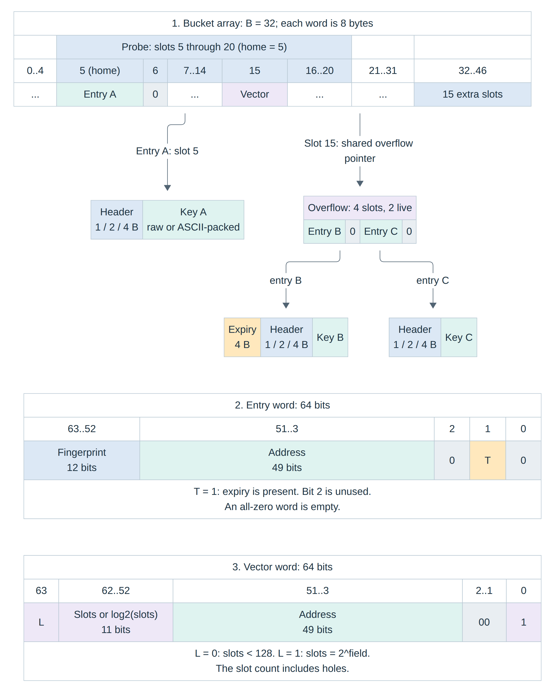
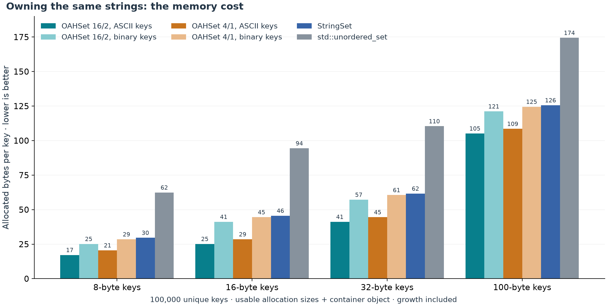
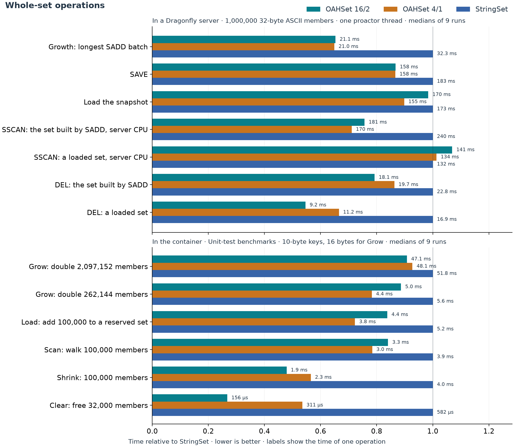
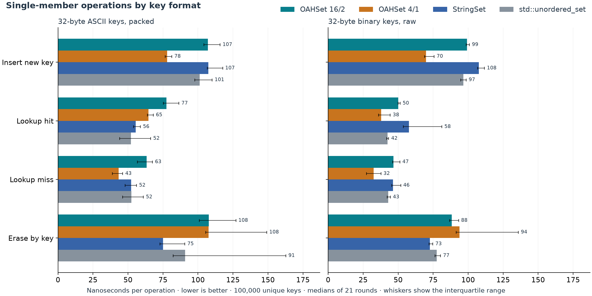

# Every byte still matters: inside Dragonfly's OAHSet

A set of 100,000 unique 16-byte ASCII strings takes **45.6 bytes per member** in Dragonfly's
StringSet. OAHSet stores the same set in **25.2 bytes**, 45% less. The standard C++
`std::unordered_set` needs **94.4 bytes**.

OAHSet is Dragonfly's open-addressing hash set for strings. Since v2.1, it is used by default, and
`--use_oah_set=false` brings back StringSet. Two compile-time constants decide how OAHSet trades
memory for speed. This article explains how we think about that trade, how OAHSet lays out its
members, and what two settings of the constants cost. The accent is on the operations that process
a whole set, such as resizing, saving, and loading, because those are the ones that move a
server's CPU usage and latency.

## How we think about a set in a database

Three resources shape the design. **CPU time is scarce**: each Dragonfly shard runs on one thread,
so a cycle spent inside a set is a cycle that every other command on the shard waits for.
**Memory is scarce**: it is what a deployment pays for, and a set's overhead is multiplied by
every member it holds. **Memory bandwidth is plentiful**: a database holds far more data than the
CPU caches and touches it in no predictable order, so almost every visit to a set misses the
cache, whatever the layout. Time goes into misses that must wait for each other. Once the CPU
waits for one cache line, a few adjacent lines arrive almost for free. Memory works like a bus
service: you wait ages for one cache line, and then three arrive at once.

So OAHSet spends bandwidth, the plentiful resource, to save the other two. A lookup reads a window
of adjacent slots at once and compares their cached fingerprints with SIMD instructions, instead
of following a chain of pointers in which every link is another wait. The index stays so small
that a member costs only a few bytes beyond its key. Where the two scarce resources conflict,
memory usually wins: ASCII keys are packed into smaller allocations at the cost of a few cycles
per key.

Finding the balance took a while. The first version probed windows of 4 slots and grew once it
held one member per slot. Even without SIMD, it beat StringSet in most of its benchmarks, which
proved the approach. We expected bigger windows to improve memory locality and reduce memory
consumption, making growth and serialization much faster but insertions slower.

SIMD probing made wide windows cheap, so we tried 32-slot windows and let the table fill up to two
members per slot before growing. They performed well enough and saved a lot of memory. A month
later, when we added more benchmarks, we went back to 4 slots and one member per slot, and with
them came the problem the overload had solved: right after growth, half of the slots are empty,
which wastes 8 bytes per member. So we overloaded the table again, this time with 16-slot windows.
OAHSet now grows only when it holds twice as many members as slots, so even right after growth,
it holds about one member per slot.

The two constants live in [oah_table.h](../src/core/oah_table.h). `kShiftLog` is the log2 of the
window size, and `kOverloadFactor` is the average number of members per slot at which the table
grows. This article measures the default, **OAHSet 16/2**, and the first version's balance,
**OAHSet 4/1**, built from the same commit with only these two constants changed, so the numbers
can check that expectation.

## Two baselines

**StringSet**, the previous default, is the string-owning variant of
[DenseSet](../src/core/dense_set.h). Each member is an SDS string. An 8-byte bucket points to it
directly where possible; otherwise, the member borrows an empty neighboring bucket or hangs off a
16-byte collision link.

```text
StringSet memory ≈ 8 × buckets + 16 × collision links + allocated SDS strings
```

**std::unordered_set** is part of almost every hash-table benchmark, which makes it a common
yardstick: a set measured against `std::unordered_set` elsewhere can be placed next to OAHSet and
StringSet. Astronomers measure distances with standard candles; hash-table benchmarks use a `std::`
one. I used `std::unordered_set<std::string>` from GCC 13.3's libstdc++ on 64-bit Linux. Each node
holds an 8-byte next pointer, a 32-byte `std::string`, and an 8-byte cached hash: **48 bytes**,
plus 8 bytes per bucket. Strings longer than 15 characters need a separate heap buffer. This
arithmetic alone shows why we can't use standard-library containers.

## How OAHSet stores members

OAHSet keeps a flat array of 64-bit slots that point to separately allocated keys. The diagram
shows OAHSet 16/2 with 32 home buckets.



**Slots.** A slot is zero (empty), an *entry* that points to one key allocation, or a *vector*
that points to an overflow array of further slots. Allocations are 8-byte aligned and user-space
addresses fit in 52 bits, so the 49-bit address leaves 15 bits of each word for metadata, as the
word formats in the diagram show. Bit 0 tells entries from vectors, and `T` marks a key
allocation that starts with an expiry time. An entry keeps a 12-bit fingerprint in its top bits;
a vector keeps its slot count there, or the count's log2 from 128 slots on.

**Probe windows.** The table has `B` home buckets, a power of two, plus 15 extra slots. The top
`log2(B)` bits of a member's hash select its home bucket `b`. The member lives in its probe
window, slots `b` to `b + 15`, or in the overflow array behind slot `b | 15`. In the diagram, a
member of bucket 5 can sit in slots 5–20. Home buckets 0–15 share the overflow slot 15, and
buckets 16–31 share slot 31. Each shared slot lies inside the windows of all 16 buckets of its
group, and its array holds only their members. The extra slots let the last windows run past `B`
without wrapping. Empty slots can appear anywhere, including inside overflow arrays. In OAHSet
4/1, windows and groups have 4 slots, and the table has 3 extra slots. The diagram is schematic:
field widths and allocation sizes are not to scale.

**Fingerprints.** Each entry caches 12 bits of its member's hash. The top 4 repeat the low 4 bits
of the home bucket number, which is exactly what tells apart the buckets whose members can meet
in one window or overflow array; the other 8 bits filter further. OAHSet 4/1 needs only 2 bits
for the bucket and filters with 10. A lookup reads a key only after its fingerprint matches.
Together with the slot position, the fingerprint also gives an entry's home bucket without reading
the key, which shrinking and `SCAN` rely on.

**Compact keys.** A key allocation holds an optional 4-byte expiry, a 1-, 2-, or 4-byte header
with the length and a packing flag, and the key bytes, without a terminator. ASCII keys of 8–128
bytes are packed at 7 bits per character; all other keys stay raw. ASCII has been a 7-bit code
since 1963; OAHSet just stopped paying for the eighth bit. For a 16-byte ASCII key without expiry:

```text
StringSet:          16 data bytes + 1 SDS header byte + 1 terminator = 18 requested → 32 allocated
OAHSet:             14 packed bytes + 1 key header byte              = 15 requested → 16 allocated
std::unordered_set: 16 data bytes + 1 terminator                     = 17 requested → 32 allocated
```

Allocations are rounded up to mimalloc's size classes, which are 16 bytes apart for small sizes, so
17 or 18 requested bytes take 32. Packing moves this key into the 16-byte class, which halves its
allocation. `std::unordered_set` adds its 48-byte node on top.

## How OAHSet uses the layout

**Lookup.** OAHSet packs the query like a stored key and hashes it. SIMD instructions compare the
query's fingerprint with every slot of the window, for example four slots per instruction with
AVX2. If no member matches and the group's shared slot holds a vector, the overflow array is
scanned the same way. Each fingerprint match is confirmed by comparing the packing flag, the
length, and the key bytes.

**Insertion.** `Add` allocates the new key before it checks for a duplicate, so adding an existing
member costs an allocation and a free. A new member takes the first empty slot of its window. If
the window is full, the member goes to the group's overflow array; if the shared slot still holds
an entry, that entry and the new member move into a new 2-slot array. Overflow arrays reuse empty
slots, grow by 2 slots up to 128, and then double.

**Deletion.** `Erase` frees the key, clears its slot, and frees an overflow array once it is
empty. Lookups never stop at an empty slot, so deletion needs no tombstones and no shifting.

**Resizing.** The set grows before an insertion once it holds `kOverloadFactor` members per slot.
In OAHSet 16/2, that means `2 × (B + 15)` members, so at least half of them are in overflow arrays
by then. Growth at least doubles `B` and rehashes every key, which means reading it. After an
`Erase` leaves fewer than `B / 2` members, the set shrinks to the member count rounded up to a
power of two, computing the new positions from fingerprints and slots alone. Resizing moves only
slot words; keys stay where they are.

**Prefetching.** A cache miss costs less when the CPU has other work to do while it waits, so
OAHSet requests memory before it needs it. As soon as `Add` knows the home bucket, it requests the
window's first cache line, then allocates and copies the new key while that line is on its way.
Before it probes the window, `Add` also requests whatever the group's shared slot points to,
usually an overflow array, which it searches whenever the window holds no match. For each home
bucket, a scan requests the key or array behind every slot of the window before it compares
fingerprints. A scan visits buckets in order and windows overlap, so it usually requests a window's
keys several buckets before it reports them, with many misses in flight at once. Lookups, erasure,
resizing, and the iterator don't prefetch. With the prefetches compiled out, a full scan of
1,000,000 members took 11–18% longer in my measurements, while insertion slowed by at most 2.4%,
which is within the noise.

**Expiry, scans, and threads.** A member's expiry is an absolute time in seconds, stored in front
of its key. Reads and `Add` delete expired members lazily. The `SCAN` cursor is a hash prefix, so
a scan survives resizing and still reports every member present for the whole scan at least once.
A `std::unordered_set` iterator can't do that: rehashing invalidates it. Like everything in a
Dragonfly shard, an OAHSet belongs to one thread and needs no locks. The code lives in
[oah_set.h](../src/core/oah_set.h) and [oah_table.h](../src/core/oah_table.h).

## Memory: the index and the strings

The numbers below count every live allocation: the index, the keys with their allocator rounding,
and the container object. They exclude input buffers, allocator page metadata, and retained free
pages, so they are not process RSS. All containers own their strings and allocate through
mimalloc 2.5.2; `std::unordered_set` keeps its default maximum load factor of 1.0. Each set holds
**100,000 unique keys** and grows from empty. ASCII keys use a 64-character alphabet; binary keys
start with bytes that have the high bit set, so OAHSet stores them raw.

| Bytes per member | 8 B | 16 B | 32 B | 100 B | 256 B |
| --- | ---: | ---: | ---: | ---: | ---: |
| OAHSet 16/2, ASCII keys | 17.2 | 25.2 | 41.2 | 105.2 | 329.2 |
| OAHSet 16/2, binary keys | 25.2 | 41.2 | 57.2 | 121.2 | 329.2 |
| OAHSet 4/1, ASCII keys | 20.5 | 28.6 | 44.5 | 108.5 | 332.5 |
| OAHSet 4/1, binary keys | 28.5 | 44.5 | 60.6 | 124.5 | 332.5 |
| StringSet | 29.6 | 45.6 | 61.6 | 125.6 | 333.6 |
| std::unordered_set | 62.4 | 94.4 | 110.4 | 174.4 | 382.4 |

StringSet and `std::unordered_set` use the same memory for both key formats.



The index is where the two OAHSet builds differ. At 100,000 members, OAHSet 16/2 spends 9.2 bytes
per member on slots and overflow arrays, OAHSet 4/1 spends 12.5, StringSet's buckets and collision
links take 13.6, and `std::unordered_set` needs 62.4 for its nodes and buckets, with strings of up
to 15 characters stored inside the nodes. The other saving comes from the keys. For 32-byte ASCII
keys, OAHSet 16/2 saves **33% against StringSet** and **63% against std::unordered_set**; 16 of
the 20.5 bytes saved against StringSet come from the smaller key allocation. OAHSet 4/1 gives back
3.3 bytes per member and still saves 28% against StringSet. Binary keys keep only the index
saving, and ASCII keys longer than 128 bytes are stored raw as well, so at 256 bytes the saving
falls to about 1%.

Reserving capacity helps `std::unordered_set` most. For 32-byte ASCII keys, it lowers that set
from 110.4 to 105.2 bytes per member, as its load factor rises from 0.58 to 0.93. StringSet goes
from 61.6 to 60.4, and both OAHSet builds stay where they are. Per-member memory barely changes
between 1,000 and 1,000,000 members.

## Not all commands are equal

All timings come from one logical CPU of an AMD Ryzen AI Max+ 395 (Zen 5, 32 MB of L3 cache per
8-core complex) under the performance governor, with Release builds by GCC 13.3 for
`-march=haswell`, so the probes use AVX2. Dragonfly's x86 release packages target SSE4.1, where a
probe takes more instructions; I did not measure them.

Most commands touch one member, and for them the set is a small part of the work: the server
parses the command, finds the key, and writes the reply, and the kernel moves both through a
socket. With a set of 1,000,000 members and a server thread saturated with `SISMEMBER` for random
members, Dragonfly spent 5.8 µs of CPU time per command when 60 connections sent one command at a
time, and 0.9 µs when 6 connections pipelined 32 commands each. The three sets cost the same per
command within 3%. The lookup itself takes about 0.25 µs in a set this large and 0.05–0.08 µs in
one that fits in the cache.

A few operations visit every member. Their cost grows with the set, and some run without a break,
so they decide how much CPU time a large set costs and how long the other clients of its shard
wait. Dragonfly runs them in different ways.

**Growth** happens inside the `SADD` that crosses the threshold and rehashes every member before
the command replies. No other command runs on the shard meanwhile.

**Saving**, by `SAVE`, `BGSAVE`, or a replica's full sync, walks the set with its iterator, decodes
every member, and passes on about 64 KB at a time. Other commands run between the chunks.

**Loading** reserves the saved number of members once and adds them in batches of up to 4,092. A
server or replica that loads does not serve data commands until it finishes, so loading time is
time without service.

**Scanning** with `SSCAN` stops each call after `COUNT` members or about 0.1 ms, so no call takes
long, but a full walk costs CPU time in proportion to the set.

**Deletion** by `DEL` frees every member before the command replies. `UNLINK` frees the set in
steps of 1,024 slots, or buckets in StringSet, while the thread has nothing else to do.

**Shrinking** happens automatically only in OAHSet, inside the `SREM` or `SPOP` that leaves fewer
than `B / 2` members; the `SHRINK` command shrinks either set on demand. OAHSet computes the new
positions without reading keys.

To see these operations from a client's side, I ran Dragonfly with one thread and built a set of
1,000,000 random 32-byte ASCII members with `SADD` calls of 1,000 members each. The server then
saved the set three times, deleted it and loaded the snapshot back three times, and freed the last
loaded set with `UNLINK`; `SSCAN` walked both the set built by `SADD` and a loaded one. A probe
connection sent `PING` about every 0.15 ms and recorded how long each reply took, which is how
long any other client would have waited. Medians of nine runs, each with new servers:

| 1,000,000 members | OAHSet 16/2 | OAHSet 4/1 | StringSet |
| --- | ---: | ---: | ---: |
| Memory per member, bytes | 40.8 | 43.7 | 60.1 |
| Longest `SADD` call, ms | 21.1 | 21.0 | 32.3 |
| `SAVE`, ms | 158.4 | 158.3 | 182.6 |
| `SAVE`, CPU ms | 122.3 | 122.3 | 138.2 |
| Longest wait during `SAVE`, ms | 2.1 | 2.1 | 2.0 |
| Loading, ms | 170.0 | 155.2 | 172.7 |
| `SSCAN` walk of the built set with `COUNT 1000`, CPU ms | 181.2 | 170.3 | 239.6 |
| `SSCAN` walk of a loaded set with `COUNT 1000`, CPU ms | 141.2 | 133.8 | 132.1 |
| `DEL` of the built set, ms | 18.1 | 19.7 | 22.8 |
| `DEL` of a loaded set, ms | 9.2 | 11.2 | 16.9 |
| `UNLINK` until the memory is free, ms | 13.4 | 15.4 | 19.9 |
| Longest wait during `UNLINK`, ms | 0.17 | 0.39 | < 0.1 |

Memory per member matches the container measurements: OAHSet 16/2 used 32% less than StringSet,
and OAHSet 4/1 27% less.

**Growth** caused the longest stall. In every run, the slowest `SADD` was the call that grew the
table at about 524,000 members: 21 ms in both OAHSet builds and 32 ms in StringSet, or about 40 and
62 ns per rehashed member. Every other client of the shard waited that long.

**Saving** never blocked the shard for more than about 2 ms. Its cost is CPU time: 122 ms in both
OAHSet builds and 138 ms in StringSet. A bare loop over the iterator ranks the sets the other way
round. It visits StringSet's 1,000,000 members in 21.7 ns each and OAHSet's in 29.1 ns, because
the CPU keeps more than four of StringSet's cache misses in flight at once but only about two of
OAHSet's, whose loop also unpacks every key. In `std::unordered_set`, whose nodes form one linked
list, each miss waits for the one before, and a member takes 86.5 ns. `SAVE` runs about 470 more
instructions per member, and with that much work in between, only one or two misses overlap in
OAHSet or StringSet, so what decides is how often the CPU stalls. Per saved member, hardware
counters show OAHSet 16/2 executing 15% more instructions than StringSet, but mispredicting 0.51
branches against 0.92 and fetching 0.57 cache lines from DRAM against 1.23, plausibly because its
set is a third smaller and more of it stays in the cache. It needed 17% fewer cycles.

**Loading** favors OAHSet 4/1, which loaded the snapshot in 155 ms, against 170 for OAHSet 16/2
and 173 for StringSet. Loading reserves room for the saved members, which gives OAHSet 4/1 about
one slot per member. OAHSet 16/2 gets half as many slots and puts about half of its members into
overflow arrays, which grow 2 slots at a time.

**Walking and deleting** depend on where the keys lie in memory. `SADD` allocates keys in the order
the members arrive, which is random with respect to the table. Loading allocates them in the order
the table lists them, so a later walk over a loaded set reads memory almost sequentially. In the
set built by `SADD`, a full `SSCAN` walk cost OAHSet 24–29% less CPU time than StringSet, and `DEL`
blocked the shard for 18–20 ms against 23. In loaded sets, all three walked in 132–141 ms of CPU
time, and `DEL` took 9–11 ms in OAHSet against 17 in StringSet. Re-adding a built set's members in
`SSCAN` order had the same effect on the walk as loading, so the order of the allocations is what
matters. A long-running server holds sets like the built one; a restarted server or a replica
after a full sync holds loaded ones.

`UNLINK` returns almost at once and frees the set in steps while the thread has nothing else to
do. The memory was free after 13 ms in OAHSet 16/2, 15 ms in OAHSet 4/1, and 20 ms in StringSet,
and no `PING` waited longer than 0.4 ms.

The figure sets these results next to Dragonfly's unit-test benchmarks, which time the same
operations inside the containers, without a server around them:



Inside the containers, OAHSet is ahead in every whole-set operation. For the sets in the figure,
growth takes 7–22% less time than in StringSet, a full scan 16–22% less, and adding members to a
reserved set, as loading does, 16–28% less. The gap is widest for shrinking, which OAHSet does
without reading keys: OAHSet 16/2 shrinks a set in 19 ns per member whatever the key size, while
StringSet rehashes every key, in 40 ns per member with 10-byte keys and 149 ns with 1000-byte keys.
Clearing a set of 32,000 members takes 4.9 ns per member in OAHSet 16/2, 9.7 in OAHSet 4/1, and
18.2 in StringSet. The unit tests have no `std::unordered_set` version, but the harness described
below does: adding 1,000,000 32-byte ASCII members one at a time to a reserved set takes 158 ns per
member in OAHSet 16/2, 112 in OAHSet 4/1, 249 in StringSet, and 222 in `std::unordered_set`.

## Single-member operations

Single-member operations show the trade between the two balances most directly. Dragonfly's unit
tests define the same `BM_Add`, `BM_Get`, and `BM_Erase` benchmarks for both sets, in
[oah_set_test.cc](../src/core/oah_set_test.cc) and
[string_set_test.cc](../src/core/string_set_test.cc). Their random keys use a 36-character
alphabet, so OAHSet packs the 10- and 100-byte keys and stores the 1000-byte keys raw. `BM_Add`
reserves capacity and inserts every key, `BM_Get` looks up every key of a set built without
reservation, and `BM_Erase` removes every key, including OAHSet's shrinking. Medians of nine runs:

| ns per member, 100,000 members | 10-byte keys | 100-byte keys | 1000-byte keys |
| --- | ---: | ---: | ---: |
| Add, OAHSet 16/2 | 43.7 | 52.2 | 116.1 |
| Add, OAHSet 4/1 | 37.7 | 47.6 | 133.1 |
| Add, StringSet | 52.1 | 63.8 | 243.1 |
| Get, OAHSet 16/2 | 42.6 | 52.7 | 101.8 |
| Get, OAHSet 4/1 | 41.9 | 48.3 | 96.3 |
| Get, StringSet | 35.9 | 48.6 | 183.9 |
| Erase, OAHSet 16/2 | 61.6 | 70.6 | 131.5 |
| Erase, OAHSet 4/1 | 80.7 | 90.9 | 169.2 |
| Erase, StringSet | 41.8 | 55.0 | 202.8 |

OAHSet 4/1 adds 10- and 100-byte keys 9–14% faster than OAHSet 16/2 and finds them up to 8%
faster, but erases them about 30% slower, shrinking included. StringSet finds and erases short
keys fastest; OAHSet pays for packing them, as explained below. With 1000-byte keys, the 100,000
members take about 100 MB, far more than the cache, and both OAHSet builds add and find them about
twice as fast as StringSet.

These benchmarks leave out misses, binary keys, sets of a million members, and
`std::unordered_set`. A separate harness adds them. It feeds the same keys to all four sets, runs
lookups and erasure in shuffled order, and reports the median of 21 rounds from three processes.
Each round times a whole batch of operations, so the results describe throughput, not the latency
of single operations. For 32-byte ASCII keys:

| ns per operation, 32-byte ASCII keys | OAHSet 16/2 | OAHSet 4/1 | StringSet | std::unordered_set |
| --- | ---: | ---: | ---: | ---: |
| Insert, 100,000 members | 107.0 | 77.9 | 107.4 | 101.2 |
| Hit, 100,000 members | 77.4 | 64.7 | 55.6 | 52.1 |
| Miss, 100,000 members | 63.3 | 43.4 | 52.3 | 52.4 |
| Erase, 100,000 members | 107.8 | 107.6 | 75.0 | 90.9 |
| Insert, 1,000,000 members | 243.7 | 149.6 | 329.8 | 354.2 |
| Hit, 1,000,000 members | 264.0 | 250.8 | 250.9 | 239.5 |
| Miss, 1,000,000 members | 268.1 | 139.9 | 224.1 | 230.4 |
| Erase, 1,000,000 members | 346.8 | 358.6 | 373.3 | 432.6 |



**Why OAHSet 4/1 is faster.** Its 4-slot window fills half a cache line, and its table grows at one
member per slot, so most members sit in their windows: an insertion usually finds an empty slot at
once, and a miss usually ends after one window. OAHSet 16/2 fills its table up to two members per
slot. At 1,000,000 members, it holds 1.9 per slot, so about half its members live in overflow
arrays and every group has one. A miss then reads a window and an overflow array, one after the
other, which is why it takes 268 ns instead of 140. Hits at that size cost about the same in every
set, because they mostly wait for the key itself.

**Packed keys.** With binary keys, which OAHSet stores raw, hits in the 100,000-member set take
50.1 ns in OAHSet 16/2 and 37.8 ns in OAHSet 4/1, against 57.8 ns in StringSet and 42.4 ns in
`std::unordered_set`. Both key formats take the same path through the table; the difference lies
in preparing the query. OAHSet packs a query into a stack buffer with several narrow stores, some
of them overlapping, and the hash function and the key comparison read the buffer back right away.
No single pending store covers those loads, so the CPU cannot forward the data to them, and they
wait until the stores complete. Hardware counters for 8-byte keys showed about 49 times as many
failed store-to-load forwards for packed keys as for binary ones, with the same cache misses and
branch mispredictions.

**Erasure** is slower in OAHSet while the set fits in the cache: 108 ns against 75 in StringSet
and 91 in `std::unordered_set`. In the larger set, OAHSet is about as fast as StringSet, and
`std::unordered_set` is the slowest, at 433 ns. Small differences deserve caution: the StringSet
code is the same in both harness builds, yet its two sets of results differ by up to 12% for
lookups and 16% for erasure with 16- and 32-byte keys.

## Which balance to pick

The expectation we started with holds in part. A bigger window and a fuller table save memory:
OAHSet 16/2's index takes 9.2 bytes per member against 12.5 in OAHSet 4/1, and its set in the
server took 7% less memory in total. They cost speed when adding members and on misses: OAHSet 4/1
inserts into a growing 1,000,000-member set in 39% less time, answers misses in that set in half
the time, and loads a snapshot 9% faster. But growth took 21 ms and saving 158 ms in both builds,
so their advantage over StringSet comes from what the builds share: slots with fingerprints,
overflow arrays instead of linked chains, and compact keys. Freeing memory favors OAHSet 16/2:
`DEL`, `UNLINK`, shrinking, and clearing take 5–50% less time than in OAHSet 4/1.

OAHSet 16/2 stays the default. Memory is what a deployment pays for; growth and saving cost the
same with it, and freeing costs less. Loading and `SSCAN` cost 5–10% more, and a single-member
command costs the same in a server either way. OAHSet 4/1 suits a workload dominated by insertions
and misses that has memory to spare. Such workloads are rumored to exist. Both constants are
compile-time, so switching means rebuilding Dragonfly. Either way, the set spends memory
bandwidth, which a database has in plenty, to save the CPU time and memory it lacks.

Methodology, data, and scripts: [docs/benchmarks/oah_set](benchmarks/oah_set/README.md).

#DragonflyDB #CPP #MemoryManagement #Performance #DataStructures
