# Shared-Everything Datastore POC for `ok_main.cc` and Multi-Threaded DASH

## 1. Overview and Goals

This document specifies the design for bringing the shared-everything, intent-ordered datastore architecture (prototyped in `midi-redis`) into Dragonfly's `src/facade/ok_main.cc`, backed by a **single shared, multi-threaded `DashTable`** (`src/core/dash.h`).

### 1.1 Definitions and Core Terminology

Before describing the architecture, we define the core building blocks used throughout this document:

- **Proactor Thread & Connection Fiber**:
  Dragonfly runs one event-loop thread (**Proactor**) per CPU core. Client TCP connections live as cooperative fibers on whichever Proactor accepted them. In a **shared-everything** architecture, any connection fiber on any Proactor thread can directly read and write the shared database without sending cross-thread messages (`FiberQueue` RPCs) to a key-owning thread.
- **Key Hash (`uint64_t hash`)**:
  A 64-bit integer hash (e.g., `rapidhash(key)`) computed once when a command parses its key arguments. Different bit slices of this 64-bit hash are used to route the key to its lock stripe, DASH segment, bucket, and SIMD slot fingerprint.
- **Logical Intent (`Intent`)**:
  A lightweight logical lock request for a single key hash, acquired by multi-key operations (`MGET`, `MSET`, `MULTI`/`EXEC`, `EVAL`) before they touch physical storage. An `Intent` is requested in one of two modes:
  - **`kShared` (Read)**: Multiple concurrent readers can hold `kShared` intents on the same key hash simultaneously.
  - **`kExclusive` (Write)**: Only one writer can hold a `kExclusive` intent on a key hash, excluding all other readers and writers on that key hash.
- **Intent Queue (`IntentQueue`)**:
  A per-key-hash FIFO wait queue (`wait_head .. wait_tail`) plus active holder counters (`active_readers`, `active_writer`). It orders conflicting multi-key transactions that want the same key at the same time. An `IntentQueue` is created on demand when a multi-key transaction reserves a key and is immediately deleted when the last holder/waiter finishes—so **idle keys consume zero memory in the lock table**.
- **Key-Hash-Indexed Lock Map (`keys`)**:
  Instead of storing lock state inside every hash-table entry or indexing locks by variable-length `std::string` key names (which would require heap allocations and string comparisons during lock acquisition), active `IntentQueue`s are stored in a hash map indexed by the 64-bit integer key hash: `absl::flat_hash_map<uint64_t, IntentQueue>`. (If two distinct keys ever produce the same 64-bit hash—a $2^{-64}$ probability—they simply serialize conservatively on the same `IntentQueue` without affecting correctness.)
- **Lock Stripe (`Stripe`)**:
  If all CPU cores locked a single global mutex to access one global `flat_hash_map<uint64_t, IntentQueue>`, that mutex would become a severe bottleneck. **Lock striping** partitions the lock table into `kAdmissionStripes = 64` independent, cache-line-aligned shards called **Stripes** (`Stripe stripes_[64]`).
  - Each `Stripe` has its own `mutex`, its own `keys` map (`flat_hash_map<uint64_t, IntentQueue>`), and an atomic counter `active_keys` tracking how many key hashes currently have an active `IntentQueue` in that stripe.
  - A key's stripe is selected deterministically from 6 bits of its hash: `stripe_id = (hash >> 24) & 63`.
  - When `stripe.active_keys == 0`, no multi-key transaction is active on *any* key in that stripe, allowing single-key commands (`GET`, `SET`) to skip locking `stripe.mutex` altogether.
- **DASH Segment (`detail::Segment`)**:
  The fixed-capacity physical building block of `DashTable`. Each `Segment` contains 64 regular buckets + 4 stash buckets ($68 \times 12 = 816$ key-value slots, holding ~550–650 keys at typical load factor). In our multi-threaded design, each `Segment` has its own reader-writer lock (`SegmentLock`) that protects physical memory reads and writes inside that segment.
- **DASH Directory (`Directory`)**:
  An extendable-hashing pointer array of size $2^{\text{global\_depth}}$ that maps the most significant `global_depth` bits of a key's 64-bit hash (`hash >> (64 - global_depth)`) to the `Segment*` currently responsible for that hash prefix.
- **Logical Partition (`LogicalPartition[0..K-1]`)**:
  A **dynamically chosen** grouping of `DashTable` segments into $K = 2^p$ disjoint hash-prefix ranges ($j \in [0, K)$), used to drive parallel multi-file serialization (`...-0000.dfs .. ...-(K-1).dfs`) and parallel multi-socket replication (`DFLY FLOW 0..K-1`).
  - *Note on terminology*: We reserve the word **Stripe** exclusively for the 64 Intent Lock Stripes (`stripes_[0..63]`), and use **Logical Partition** for segment-level partitioning over `DashTable`. Unlike shared-nothing shards, the number of Logical Partitions $K$ is **not fixed at server startup**—it can be chosen dynamically per snapshot or replication session.

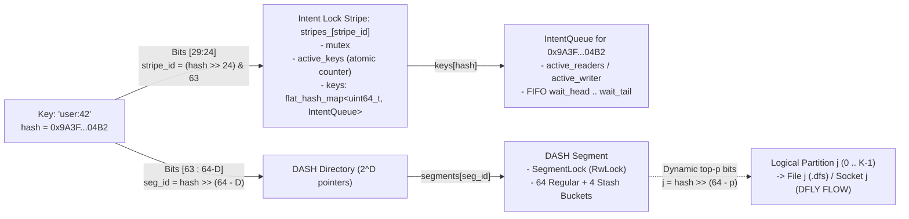

### 1.2 Core Architectural Principles

1. **Decouple Logical Multi-Key Ordering from Physical Storage Protection**:
   - **Logical conflicts** across keys—needed for multi-key atomicity (`MGET`, `MSET`, `MULTI`/`EXEC`)—are ordered via the 64 **Lock Stripes**, where each stripe maps active 64-bit key hashes to **FIFO Intent Queues** supporting **Shared (Read)** and **Exclusive (Write)** modes.
   - **Physical storage integrity** is enforced at the granularity of individual **DASH Segments** (`detail::Segment`), allowing operations on different segments—and concurrent reads on the *same* segment—to execute in parallel across proactor threads without permanent shard ownership.
2. **Eliminate Cross-Thread Queue Hops and `seq_cst` Barriers on the Common Path**:
   - Any connection fiber on any proactor thread can directly execute commands against the shared `DashTable`.
   - Uncontended single-key operations (`GET`, `SET`) execute in a single segment lock scope, bypass `stripe.mutex` when `stripe.active_keys == 0`, and rely purely on standard `acquire`/`release` semantics of `SegmentLock` (**no `seq_cst` / `dmb ish` barrier required**).
3. **Preserve Strict Serializability and Linearizability**:
   - `GET`, `SET`, `MGET`, `MSET`, and `MULTI`/`EXEC` are strictly serializable (linearizable + atomic).
   - Partial updates of `MSET` or `EXEC` are never visible to concurrent `GET`, `MGET`, or `SET`/`MSET` commands, even though segment locks are acquired and released one segment at a time rather than held across all segments simultaneously.

---

## 2. Architecture Overview

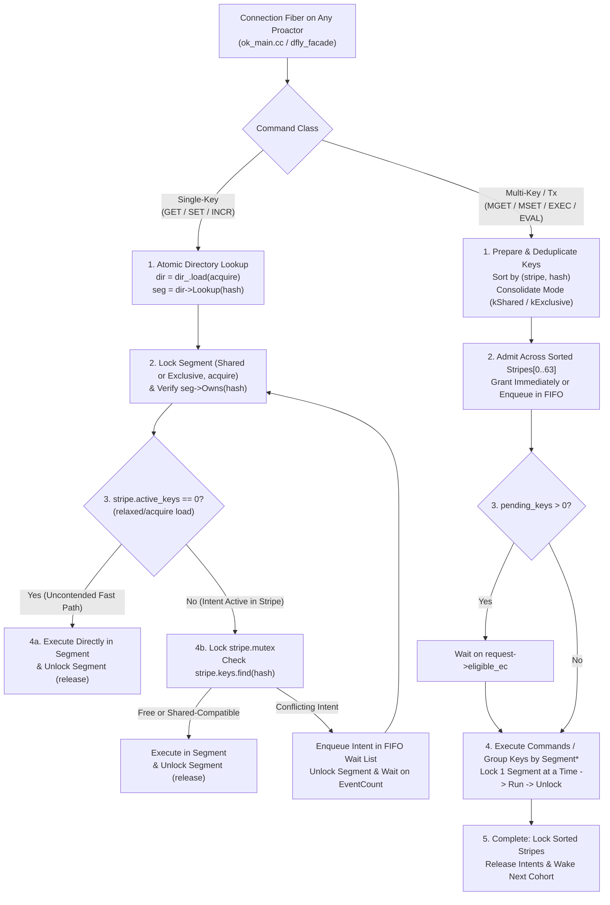

### Separation of Responsibilities

| Layer | Granularity | Responsibility | Does Not Do |
| :--- | :--- | :--- | :--- |
| **Intent Table (`Stripe[64]`)** | Key hash (`uint64_t`) | All-key logical ordering, Shared/Exclusive conflict resolution, multi-key atomicity | Protect physical DASH buckets, slots, or directory pointers |
| **DASH Directory (`Directory`)** | Table-wide | Lock-free `hash -> Segment*` routing via atomic pointer + retired directory list | Serialize individual key reads/writes |
| **DASH Segment (`Segment`)** | ~816 slots (64 regular + 4 stash buckets) | Physical bucket/slot safety, SIMD fingerprint probing, stash management, local splits | Hold locks across multiple segments for multi-key atomicity |

---

## 3. Changes to `dash.h` for Multi-Threading

Upstream `DashTable` (`src/core/dash.h` and `src/core/dash_internal.h`) assumes single-threaded access per table instance. Adapting a single `DashTable` for multi-threaded per-segment concurrency requires addressing five structural hazards:

1. **Directory reallocation and `global_depth_` races** during `IncreaseDepth()` and `Split()`.
2. **Stale segment routing** when a segment splits between directory lookup and segment lock acquisition.
3. **Physical bucket/stash mutation races** inside `detail::Segment` (neighbor probing in `MoveToOther`, stash pointer updates in `SetStashPtr`/`UnsetStashPtr`, and `UnloadStash`).
4. **Table-wide scalar counter contention and data races** (`size_`, `bucket_count_`, `unique_segments_`, `segment_id_`).
5. **Unsafe external iterators and non-atomic `SegmentPin` refcounts** escaping critical sections.

### 3.1 Hash Bit Partitioning and Pre-Hashed API

To avoid recomputing hashes and to prevent correlation between intent stripes, directory indices, bucket home indices, and SIMD fingerprints, a single 64-bit hash (`rapidhash` or `XXH64`) is partitioned into disjoint bit fields:

```text
63              64-D                  30    24        14 13       8 7          0
+------------------+--------------------+-------+----------+----------+------------+
| SegmentId (MSBs) |     Unused /       |Stripe |  Unused  |HomeBucket| Fingerprint|
|   global_depth   |   Future Growth    |6 bits |          |  6 bits  |   8 bits   |
+------------------+--------------------+-------+----------+----------+------------+
```

- **Bits `[63 : 64 - global_depth]`**: `SegmentId` in the DASH directory (already used by `DashTableBase::SegmentId`).
- **Bits `[29 : 24]`**: Intent `Stripe` index (`0..63`).
- **Bits `[13 : 8]`**: `Segment::HomeIndex` (`(hash >> 8) % 64`).
- **Bits `[7 : 0]`**: 8-bit SIMD slot fingerprint (`hash & 0xFF`).

`DashTable` should expose pre-hashed overloads for all core operations so callers compute the 64-bit hash once:
- `Find(U&& key, uint64_t key_hash)` (already present)
- `Insert(U&& key, V&& value, uint64_t key_hash)`
- `Erase(const Key_t& key, uint64_t key_hash)`

### 3.2 Lock-Free Atomic Directory and Safe Directory Doubling

In current `DashTable`, `segment_` is a `std::vector<SegmentType*>`. When a segment at `local_depth == global_depth` splits, `IncreaseDepth()` calls `segment_.resize(1ul << new_depth)`, freeing the old pointer array while concurrent threads may be indexing into it.

#### Design: Immutable-Sized `Directory` Snapshots

Replace `std::vector<SegmentType*> segment_` and `uint8_t global_depth_` with an atomically published `Directory` structure:

```cpp
struct Directory {
  const uint8_t global_depth;
  // Length is (1u << global_depth).
  std::atomic<SegmentType*>* segments;

  uint32_t SegmentId(uint64_t hash) const noexcept {
    return global_depth ? static_cast<uint32_t>(hash >> (64 - global_depth)) : 0u;
  }

  SegmentType* Lookup(uint64_t hash) const noexcept {
    return segments[SegmentId(hash)].load(std::memory_order_acquire);
  }
};
```

- `DashTable` holds:
  - `std::atomic<Directory*> dir_;`
  - `util::fb2::Mutex split_mu_;` (acquired **only** during segment splits, i.e., roughly once per ~800 new insertions).
  - `std::vector<RetiredDirectory> retired_dirs_;` (retains old `Directory` arrays after `IncreaseDepth` until safe reclamation).
- **Wait-Free Directory Lookup**:
  - Readers and writers resolve a segment with two `memory_order_acquire` loads (`dir_` then `dir->segments[idx]`) and **zero directory locks**.
  - Crucially, callers **never** hold a `Directory*` across a fiber suspension point (`seg->LockShared()` / `seg->LockExclusive()`); `dir->Lookup(hash)` completes in two CPU instructions before attempting to lock `seg`, and if `seg->Owns(hash)` fails, the retry loop reloads `dir_.load(std::memory_order_acquire)` fresh.
- **How `retired_dirs_` Are Released (and Single-Thread Coordinator Option for Directory Resize)**:
  1. **Option A: Single-Thread Coordinator + Cross-Thread Message Passing (`AwaitBrief`) for Directory Resize**:
     - Directory doubling (`IncreaseDepth` when `new_depth > global_depth`) is an extremely rare metadata event—occurring at most ~16–20 times across the entire lifetime of a table growing to hundreds of millions of keys.
     - Instead of maintaining `retired_dirs_` or contending on `split_mu_`, directory doubling (or all directory pointer updates) can be delegated via cross-thread message passing (`pp->at(kCoordinatorThread)->Await(...)`) to a single **Coordinator Thread**:
       - The Coordinator allocates `new_dir`, populates its pointers, and publishes `dir_.store(new_dir, std::memory_order_release)` (or updates each proactor's thread-local `tl_dir_` pointer via `pp->AwaitBrief(...)` across all proactors).
       - Because `pp->AwaitBrief(...)` runs a brief callback on every proactor thread and `dir->Lookup(hash)` never yields across fibers, the completion of `AwaitBrief` acts as an exact **RCU grace-period barrier (`synchronize_rcu()`)**: no thread can still be reading `old_dir`, so the Coordinator **immediately runs `delete old_dir`** with zero `retired_dirs_` accumulation!
  2. **Option B: Quiescent-State / Epoch-Based Reclamation (EBR) on Split or Heartbeat**:
     - If directory doubling is performed inline under `split_mu_`, `IncreaseDepth()` pushes `{old_dir, retire_epoch = global_epoch.fetch_add(1)}` onto `retired_dirs_`, and any entry with `retire_epoch < min_t(proactor_epoch[t])` is freed on subsequent splits or in the periodic heartbeat.
  3. **Option C: Minimal Fallback (Defer to `Clear()` / `~DashTable()`)**:
     - For the initial `ok_main.cc` POC, even if `retired_dirs_` is only cleared on `DashTable::Clear()` (`FLUSHDB` / `FLUSHALL`) and `~DashTable()`, the total memory of all retired directories from depth $0$ to $D-1$ is a geometric sum $\sum_{d=0}^{D-1} 2^d \times 8\text{ B} = (2^D - 1) \times 8\text{ B}$—which is strictly less than the size of the single active `Directory` ($< 0.18\%$ of the segment memory at depth $D$, e.g., $< 512\text{ KB}$ for 40M keys).

### 3.3 Segment Prefix Identity and Split Revalidation (`Segment::Owns`)

Because directory lookup is lock-free, a segment `S` may split after a thread loads `S = dir->Lookup(hash)` but before the thread acquires `S`'s lock.

In extendible hashing, every `Segment` at `local_depth_ = d` owns the exact subset of the 64-bit hash space whose top `d` MSBs equal a fixed `d`-bit `prefix_`:
- At table initialization (`initial_depth_ = d`), segment `i` (`0 <= i < 2^d`) is initialized with `local_depth_ = d` and `prefix_ = i`.
- When segment `S` with `(local_depth_ = d, prefix_ = p)` splits into `S` (left) and `S_new` (right):
  - `S` (left child) is updated to `local_depth_ = d + 1`, `prefix_ = (p << 1) | 0`.
  - `S_new` (right child) is constructed with `local_depth_ = d + 1`, `prefix_ = (p << 1) | 1`.

Adding `uint64_t prefix_` to `detail::Segment` makes ownership verification a pure, constant-time, segment-local check:

```cpp
bool Owns(uint64_t hash) const noexcept {
  uint8_t d = local_depth_.load(std::memory_order_relaxed);
  return d == 0 || (hash >> (64 - d)) == prefix_;
}
```

#### Lookup-and-Lock Loop

Whenever a fiber acquires a segment lock (Shared or Exclusive) for `hash`:

```cpp
SegmentType* LockSegmentForHash(uint64_t hash, bool exclusive) {
  while (true) {
    Directory* dir = dir_.load(std::memory_order_acquire);
    SegmentType* seg = dir->Lookup(hash);
    if (exclusive) {
      seg->LockExclusive();
    } else {
      seg->LockShared();
    }
    if (ABSL_PREDICT_TRUE(seg->Owns(hash))) {
      return seg;
    }
    // Segment split while we waited for its lock and `hash` moved to the right child.
    if (exclusive) {
      seg->UnlockExclusive();
    } else {
      seg->UnlockShared();
    }
  }
}
```

Note that if `S` split while the fiber waited, and `hash` belongs to the **left** child (`S` itself), `seg->Owns(hash)` still evaluates to `true` and the fiber proceeds immediately without retrying.

### 3.4 Concurrent Segment Split Protocol

When a fiber holds `seg->LockExclusive()` on segment `S` and `S->Insert(...)` reports that `S` is full:

1. **Allocate and Populate Right Sibling Under `S`'s Exclusive Lock**:
   - Compute `uint8_t new_depth = S->local_depth() + 1`.
   - Allocate `SegmentType* S_new = ConstructSegment(new_depth, (S->prefix() << 1) | 1)`.
   - Run `S->Split(hash_fn, S_new, on_move_cb)`:
     - Updates `S->local_depth_ = new_depth` and `S->prefix_ = (S->prefix() << 1) | 0`.
     - Redistributes entries whose `new_depth`-th MSB is `1` into `S_new`.
     - Redistributes `S`'s remaining stash entries where possible.
     - Updates `S->size_` and `S_new->size_`.
   - Note: `S_new` is not yet visible in `dir_`, and `S` is exclusively locked by the current fiber. No other thread can access `S` or `S_new` during data movement, and `split_mu_` does **not** need to be held while moving entries.
2. **Pre-Lock `S_new` if Needed**:
   - If the triggering key (or subsequent keys in the caller's batch) belongs to `S_new` (`S_new->Owns(key_hash)`), call `S_new->LockExclusive()` *before* publishing `S_new` to `dir_`. Because `S_new` is still private, this acquisition is guaranteed to succeed uncontended.
3. **Publish `S_new` to Directory Under `split_mu_`**:
   - Lock `split_mu_` (strict lock order: `Segment Lock -> split_mu_`).
   - Load `Directory* cur_dir = dir_.load(std::memory_order_relaxed)`.
   - **Case A: Local Split (`new_depth <= cur_dir->global_depth`)**:
     - Compute the directory range for `S_new`:
       - `half_chunk = 1u << (cur_dir->global_depth - new_depth)`
       - `target_start = static_cast<uint32_t>(S_new->prefix() << (cur_dir->global_depth - new_depth))`
     - For `i` in `[target_start, target_start + half_chunk)`:
       - `cur_dir->segments[i].store(S_new, std::memory_order_release);`
   - **Case B: Global Split (`new_depth == cur_dir->global_depth + 1`)**:
     - Allocate `new_dir` with `global_depth = new_depth` and `1u << new_depth` entries.
     - For `i` in `[0, 1u << cur_dir->global_depth)`:
       - `SegmentType* s = cur_dir->segments[i].load(std::memory_order_relaxed);`
       - `new_dir->segments[2 * i].store(s, std::memory_order_relaxed);`
       - `new_dir->segments[2 * i + 1].store(s, std::memory_order_relaxed);`
     - Set `new_dir->segments[S_new->prefix()].store(S_new, std::memory_order_relaxed);`
     - Publish `dir_.store(new_dir, std::memory_order_release);`
     - Move `cur_dir` into `retired_dirs_`.
   - Increment `unique_segments_` and `bucket_count_` under `split_mu_`.
   - Unlock `split_mu_`.
4. **Complete the Pending Insertion**:
   - Insert the key into whichever of `S` or `S_new` owns `key_hash`, then release the held segment lock(s).

Also remove `segment_[i]->set_segment_id(offs)` from `IncreaseDepth()`: a segment's canonical directory start index at any depth `gd` is simply `seg->prefix() << (gd - seg->local_depth())`, eliminating the cross-segment write to `segment_id_` during directory doubling.

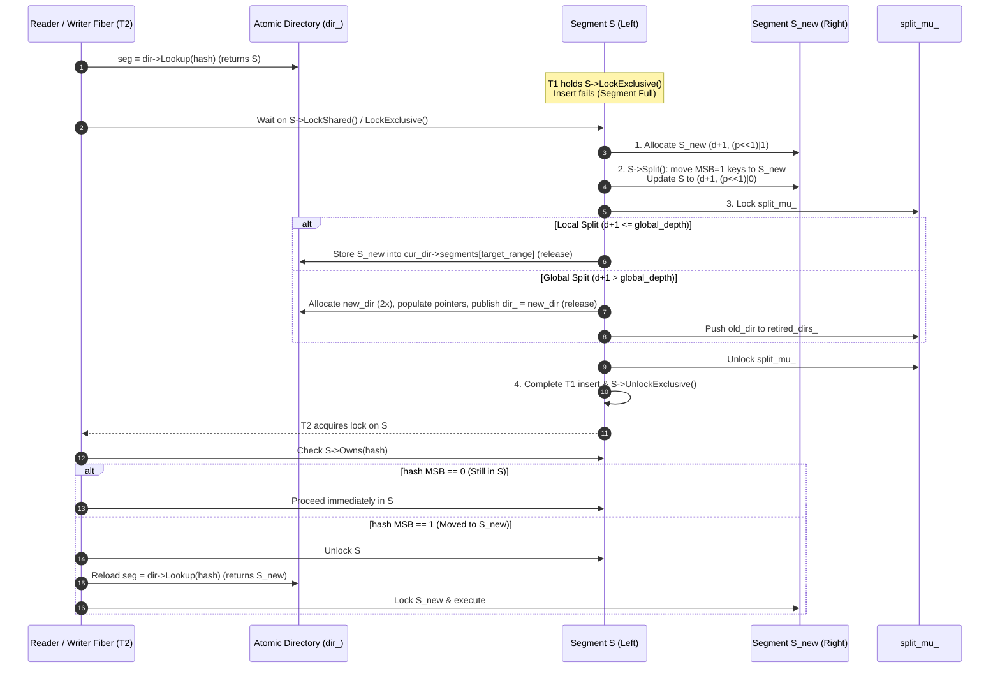

### 3.5 Physical Segment Synchronization: Direct Fiber Locks vs. Delegated Executor Tokens

Once logical intents are satisfied, threads need synchronized physical access to individual DASH segments. Below we compare the two candidate mechanisms.

#### Option A: Direct Per-Segment Fiber Reader-Writer Lock (`SegmentLock`)

Each `detail::Segment` embeds a compact fiber-aware reader-writer lock built on `std::atomic<uint32_t>` and `util::fb2::EventCount`:

```cpp
class SegmentLock {
  // Bit 0: writer active; Bit 1: writer waiting (blocks new readers for writer fairness);
  // Bits 2..31: active shared reader count.
  static constexpr uint32_t kWriterActive = 1u << 0;
  static constexpr uint32_t kWriterWaiting = 1u << 1;
  static constexpr uint32_t kReaderStep = 1u << 2;

  std::atomic<uint32_t> state_{0};
  util::fb2::EventCount ec_;

 public:
  void LockShared() {
    uint32_t s = state_.load(std::memory_order_relaxed);
    while (true) {
      if ((s & (kWriterActive | kWriterWaiting)) == 0) {
        if (state_.compare_exchange_weak(s, s + kReaderStep, std::memory_order_acquire,
                                         std::memory_order_relaxed)) {
          return;
        }
        continue;
      }
      ec_.await([this] {
        uint32_t cur = state_.load(std::memory_order_relaxed);
        return (cur & (kWriterActive | kWriterWaiting)) == 0;
      });
      s = state_.load(std::memory_order_relaxed);
    }
  }

  void UnlockShared() {
    uint32_t prev = state_.fetch_sub(kReaderStep, std::memory_order_release);
    if ((prev - kReaderStep) == kWriterWaiting) {
      ec_.notifyAll();
    }
  }

  void LockExclusive() {
    uint32_t expected = 0;
    if (state_.compare_exchange_strong(expected, kWriterActive, std::memory_order_acquire,
                                       std::memory_order_relaxed)) {
      return;
    }
    ec_.await([this] {
      uint32_t cur = state_.load(std::memory_order_relaxed);
      if (cur & kWriterActive) {
        if ((cur & kWriterWaiting) == 0) {
          state_.fetch_or(kWriterWaiting, std::memory_order_relaxed);
        }
        return false;
      }
      if ((cur >> 2) != 0) {
        if ((cur & kWriterWaiting) == 0) {
          state_.fetch_or(kWriterWaiting, std::memory_order_relaxed);
        }
        return false;
      }
      uint32_t desired = kWriterActive;
      return state_.compare_exchange_strong(cur, desired, std::memory_order_acquire,
                                            std::memory_order_relaxed);
    });
  }

  void UnlockExclusive() {
    state_.store(0, std::memory_order_release);
    ec_.notifyAll();
  }
};
```

#### Option B: Per-Segment Delegated Executor Tokens (as in `midi-redis`)

Each `detail::Segment` embeds an executor state word (`kActive = 1`, `kPending = 2`), a `MetadataMutex queue_mutex`, an intrusive `Group* head/tail` ready queue, `Group* direct`, and `Segment* run_next`:
- An arriving thread tries `state.compare_exchange_strong(0, kActive)`. On success, it sets `direct = &group` and drains the segment on its local `RunList`.
- On failure, it locks `queue_mutex`, sets `kPending`, links `group` into `head/tail`, and leaves execution to the current segment token holder (unless the holder retired concurrently, in which case the publisher claims `kActive`).
- **Complication with Segment Splits in Option B**:
  - When a segment `S` splits into `S` and `S_new` while `Group`s from other requests are already queued in `S->head/tail`, half of the keys in those queued `Group`s now belong to `S_new`.
  - The executor draining `S` must inspect each item in a popped `Group`: if `!S->Owns(item.hash)`, it cannot execute that item on `S`. It must either split the `Group` (incrementing `request->pending_groups` and publishing a new `Group` to `S_new`) or hold both `S` and `S_new` tokens during drain until the pre-split queue is flushed.

#### Comparison of Option A vs. Option B for Per-Segment DASH

| Dimension | Option A: Direct Per-Segment `SegmentLock` (RwLock) | Option B: Delegated Executor Tokens per Segment |
| :--- | :--- | :--- |
| **Same-segment read concurrency (`GET`/`MGET`)** | **Yes** — multiple proactors read the same segment concurrently in shared mode | **No** (unless reader-token cohorts are added) — serializes all accesses to a segment |
| **Collision rate at scale** | Very low (~1,000+ segments for 500K keys $\implies <0.1\%$ segment collision rate) | Optimized for high collision rate (e.g., 3 coarse partitions in `midi-redis`) |
| **Uncontended path overhead** | 1 atomic CAS (`LockShared`/`LockExclusive`) + 1 atomic release | 1 atomic CAS (`0 -> kActive`) + `RunList` push/pop + `executors_` counter + 1 atomic CAS (`kActive -> 0`) |
| **Behavior on segment split** | Simple: waiter checks `seg->Owns(hash)` and retries directory lookup if moved | Complex: queued `Group`s in `S->head/tail` contain keys that moved to `S_new` and must be re-routed |
| **Zero-copy `GET` reply** | **Yes** — calling fiber holds `LockShared()` and can serialize directly to `ReplyBuilder` or `Payload` | **No** — delegated executor runs on another fiber/thread and must copy value into `Request::values` |
| **Extreme single-segment write hotspot** | Contending fibers park on `EventCount` and wake sequentially | Active executor batches up to 64 queued write groups on one core |

**Recommendation**: Use **Option A (`SegmentLock` RwLock)** as the primary segment synchronization mechanism for per-segment `DashTable`. Because a single `DashTable` scales to thousands of segments, segment-level lock contention on disjoint keys is negligible after initial warmup, while `LockShared()` enables true parallel reads on hot segments and avoids split-queue re-routing complexity.

### 3.6 Table and Segment Counters (`size_`)

In upstream `DashTable`, `InsertInternal` and `Erase` increment/decrement a single `DashTableBase::size_` field. Under multi-threading, this causes a data race and severe cache-line bouncing across all cores.

Changes required:
1. Move authoritative key count to `Segment`:
   - Add `std::atomic<uint32_t> size_{0};` to `detail::Segment`.
   - Under `LockExclusive()`, `Insert` increments `size_`, `Delete`/`Erase` decrements `size_`, and `Split` subtracts moved keys from `source->size_` and adds them to `target->size_` using relaxed stores (`size_.store(..., std::memory_order_relaxed)`).
2. Remove `bucket_count_ += (target->num_buckets() - num_buckets)` from `InsertInternal` (`num_buckets()` is constant per segment).
3. Update `unique_segments_` and `bucket_count_` only inside `Split()` and `Clear()` under `split_mu_`.
4. `DashTable::size()` sums `seg->size()` across distinct segments (or maintains a per-proactor sharded counter for $O(1)$ `DBSIZE`).

### 3.7 Iterators, `VersionedBB`, and Segment Stability

- **Bucket Versioning (`VersionedBB<12>`)**:
  - For pure in-memory benchmarking without snapshotting, `Policy::kUseVersion = false` (`BucketBase<12>`, 24 bytes/bucket) can be used; when Point-in-Time snapshotting is enabled (`Policy::kUseVersion = true`), `VersionedBB<12>` (32 bytes/bucket) is updated under `SegmentLock` as detailed in Section 8.
- **Segment Stability (`Merge()` and `TryRelocateSegment()`)**:
  - By default, keeping allocated `SegmentType*` instances alive for the lifetime of the `DashTable` guarantees that a `SegmentType*` loaded from `Directory::Lookup(hash)` is never deallocated while a fiber is about to lock it.
  - If `TryRelocateSegment()` or `Merge()` is enabled, retired segments set `local_depth_ = 0xFF` (`Owns(hash) == false`) and are reclaimed via Epoch-Based Reclamation (EBR), as detailed in Section 7.2.
- **Lock-Scoped Accessors Instead of Unlocked Iterators**:
  - Because `InsertUniq` can displace entries between a home bucket, its neighbor bucket (`MoveToOther`), and stash buckets (`TryMoveFromStash` / `UnloadStash`), a slot's `(bucket_id, slot_id)` is only stable while the segment lock is held.
  - Raw `DashTable::iterator` must not be used outside a segment lock scope. Instead, `DashTable` provides lock-scoped operations (`Get`, `Set`, `Delete`) and a `SegmentGuard` for batched segment execution.

### 3.8 Dynamic Logical Partitions Over `DashTable` Segments

To serialize snapshots into **multiple `.dfs` files** and stream replication across **multiple TCP sockets** (`DFLY FLOW`) in parallel, we overlay $K$ **Logical Partitions** ($j \in [0, K)$) on top of the single shared `DashTable`.

#### 1. Why a Single `DashTable` with Dynamic Logical Partitions Beats Pre-Sharded Tables
- If we used $K$ separate `DashTable` instances (or baked a fixed $K$ into the table at startup), $K$ would be frozen for the lifetime of the process—just like shared-nothing shards.
- With a **single `DashTable`** and **dynamic logical partitioning over segments**, $K = 2^p$ does **not** need to be chosen in advance:
  - A local `SAVE` can dynamically partition the table into $K = 8$ partitions ($p = 3$) to write 8 `.dfs` files in parallel.
  - A replica full sync can dynamically negotiate $K = 16$ partitions ($p = 4$) to stream over 16 parallel TCP sockets, even if the master has 32 CPUs and the replica has 16 CPUs.
  - A standard single-file `RDB` dump simply uses $K = 1$ ($p = 0$).

#### 2. Segment-Based vs. Bucket-Based Partitioning
We can define logical partitions at either the **bucket** level (`bucket_id % K == j` inside every segment) or the **segment** level. **Segment-based partitioning is strongly preferred**:
- Inside a `detail::Segment`, a single insertion can probe home bucket `b`, displace entries into neighbor buckets `b ± 1` (`MoveToOther`), or spill into the segment's 4 shared stash buckets (`stash_[0..3]`). Furthermore, when a segment is full, `CVCOnInsert` and `Split()` operate on **all 68 physical buckets of the segment as an atomic unit**.
- Under bucket-based partitioning, a single `Insert` or `Split` inside one segment would touch buckets belonging to multiple logical partitions and would have to flush pre-mutation state into multiple files/sockets simultaneously.
- Under **segment-based partitioning**, all 68 buckets of a `Segment` belong to **one and only one** Logical Partition $j$, keeping `Insert`, `MoveToOther`, `UnloadStash`, `CVCOnInsert`, and `Split` 100% localized to Partition $j$.

#### 3. Preserving Partition Membership Across Splits: Top-$p$-Bit Prefix vs. `segment_id % K`
A subtle question in extendible hashing is how to map `segment_id` to a partition $j \in [0, K)$ (where $K = 2^p$) so that **segment splits and directory doublings never move keys between partitions**:

- **Pitfall of Low-Bit Modulo (`segment_id % K == j`)**:
  In `DashTable`, `segment_id = hash >> (64 - global_depth)`.
  1. When `global_depth` increases from $D$ to $D + 1$ (`IncreaseDepth()`), every key's `segment_id` shifts left by 1 bit (`new_sid = (old_sid << 1) | bit`), which **permutes `segment_id % K` for every key in the table mid-snapshot**!
  2. Any unsplit segment with `local_depth = d < D` spans $2^{D - d}$ adjacent directory slots (`start, start + 1, ...`), which have *different* values of `sid % K`, so a single physical segment would straddle multiple partitions!
- **Solution: High-Bit Prefix Partitioning (`partition_id = hash >> (64 - p) = segment_id >> (D - p)`)**:
  Instead of taking the low $p$ bits of `segment_id`, we define Logical Partition $j \in [0, K)$ ($K = 2^p$) using the **top $p$ MSBs** of the 64-bit hash (and therefore the top $p$ bits of `segment_id` and `Segment::prefix_`):
  $$\text{partition\_id}(h, K) = h \gg (64 - p) = \texttt{segment\_id} \gg (D - p), \qquad \text{partition\_id}(S, K) = S\text{->prefix\_} \gg (S\text{->local\_depth\_} - p)$$
  This guarantees four critical properties for any dynamically chosen $K = 2^p$ (with $D \ge p$):
  1. **Uniform Distribution**: Because `rapidhash` is uniform across all 64 bits, the top $p$ bits distribute segments and keys across $j \in [0, K)$ just as uniformly as `% K`.
  2. **100% Split and Resize Invariance**: When a segment `S` at `(local_depth = d >= p, prefix = P)` splits into `S` (`(P << 1) | 0`) and `S_new` (`(P << 1) | 1`), **both children have the exact same top $p$ prefix bits (`j`)**. Even if `Directory` doubles (`D -> D + 1`) during a snapshot or replication, zero keys ever cross a Logical Partition boundary.
  3. **Direct `DashCursor` Range Mapping**: Because `DashCursor(depth, seg_id, bid)` left-aligns `seg_id` at bit 40 (`(uint64_t(seg_id) << (40 - depth)) | bid`), Logical Partition $j \in [0, K)$ is simply the contiguous `DashCursor` range:
     $$\text{Cursor}_{\text{begin}}(j) = \texttt{DashCursor}(p, j, 0), \qquad \text{Cursor}_{\text{end}}(j) = \texttt{DashCursor}(p, j + 1, 0)$$
     In a directory of depth $D \ge p$, Partition $j$ is the contiguous directory slice `dir->segments[j << (D - p) .. ((j + 1) << (D - p)) - 1]`.
  4. **Tiny-Table Edge Case (`local_depth < p`)**: If a snapshot with $K = 2^p$ starts on a nearly empty table where a segment `S` still has `local_depth = d < p`, `S` is assigned deterministically to partition `j = S->prefix_ << (p - d)` (its lowest partition index), while the other $2^{p - d} - 1$ sub-partitions in `S`'s prefix range are empty (or `S` can be pre-split to depth $p$).

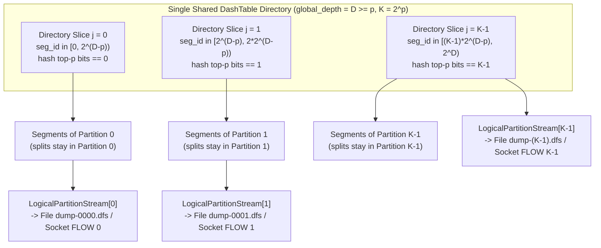

---

## 4. Transactional Framework with Shared/Exclusive Intent Locks

### 4.1 Why Intent Locks Are Needed Alongside Segment Locks

Locking individual DASH segments protects physical memory during a single segment access, but does **not** by itself provide multi-key atomicity (`MGET`, `MSET`):
- Holding multiple segment locks simultaneously across an entire `MGET`/`MSET` would reintroduce hold-and-wait convoys (blocking unrelated keys that happen to share one of the locked segments) and require re-sorting segment locks whenever a segment splits.
- Instead, **logical intents** reserve only the specific key hashes involved in a transaction. Once a transaction's intents are granted on all its keys, it can lock, access, and immediately unlock each affected DASH segment one by one (or in parallel). Its logical intents remain held until **all** segments have been processed, preventing any conflicting reader or writer on those keys from observing an intermediate multi-key state.

### 4.2 Striped Intent Table and Reader/Writer FIFO Queue

The intent manager owns `kAdmissionStripes = 64` cache-line-aligned `Stripe`s:

```cpp
enum class IntentMode : uint8_t { kShared, kExclusive };

struct Intent {
  Request* request = nullptr;
  uint64_t hash = 0;
  uint16_t stripe = 0;
  IntentMode mode = IntentMode::kExclusive;
  Intent* next = nullptr;  // Intrusive link in IntentQueue::wait_head..wait_tail
};

struct IntentQueue {
  Intent* wait_head = nullptr;
  Intent* wait_tail = nullptr;
  uint32_t active_readers = 0;
  bool active_writer = false;

  bool CanGrantShared() const noexcept {
    // Readers can join immediately only if no writer is active AND no writer is waiting.
    return !active_writer && wait_head == nullptr;
  }

  bool CanGrantExclusive() const noexcept {
    return !active_writer && active_readers == 0 && wait_head == nullptr;
  }
};

struct alignas(64) Stripe {
  MetadataMutex mutex;
  std::atomic<uint32_t> active_keys{0};  // Number of live entries in `keys`
  absl::flat_hash_map<uint64_t, IntentQueue> keys;
};
```

#### Key Property: Granted Intents Are Not in the Linked List

Only **waiting (blocked)** intents are linked into `wait_head` / `wait_tail`. Once an intent is granted:
- A `kShared` intent is represented by `active_readers > 0`.
- A `kExclusive` intent is represented by `active_writer == true`.

This design has three major advantages:
1. **Out-of-Order Reader Completion in $O(1)$**: When multiple `GET`/`MGET` requests share a key concurrently (`active_readers > 1`), they may finish in any order. Releasing a shared intent simply decrements `active_readers` under `stripe.mutex` without unlinking from the middle of a queue.
2. **Singly-Linked Wait Queue**: Only `Intent* next` is needed on `Intent`.
3. **Strict FIFO Fairness & Reader Cohort Wakeup**:
   - Any reader arriving while a writer is queued (`wait_head != nullptr`) sees `CanGrantShared() == false` and queues *behind* the waiting writer, preventing writer starvation and preserving real-time ordering.
   - When an active writer completes (`active_writer = false`), if `wait_head->mode == IntentMode::kShared`, it pops **all contiguous `kShared` intents** from the front of `wait_head`, increments `active_readers` for each, and decrements each request's `pending_keys`.
   - When the last active reader in a cohort finishes (`--active_readers == 0`) and `wait_head != nullptr`, `wait_head` is guaranteed to be a `kExclusive` intent; it pops that single writer, sets `active_writer = true`, and decrements its `pending_keys`.

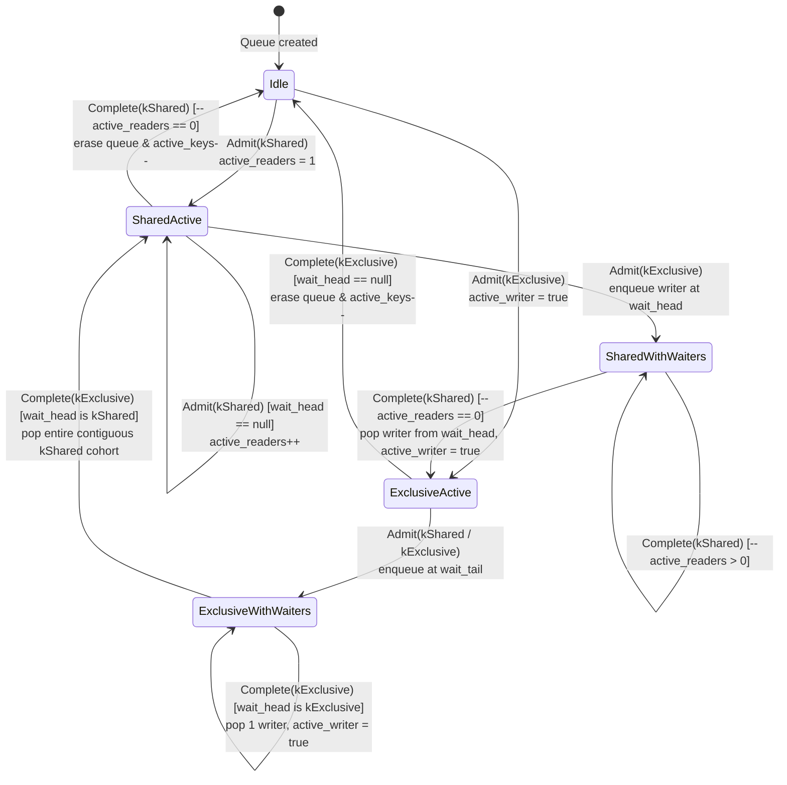

### 4.3 Multi-Key Request Lifecycle (`MGET` / `MSET`)

#### 1. `Prepare(Request*)`
- Compute `hash = rapidhash(key)`, `stripe = (hash >> 24) & 63` for each argument.
- Sort item indices by `(stripe, hash)` to build:
  - `request->stripes`: sorted, unique stripe IDs.
  - `request->intents`: one `Intent` per distinct `hash` (`IntentMode::kShared` for `MGET`, `IntentMode::kExclusive` for `MSET`).
- Note: Duplicate keys in `MGET k k` or `MSET k v1 k v2` share a single `Intent` on `hash(k)`, while all original items are retained in argument order so `MGET` fills both result slots and `MSET` applies last-write-wins.

#### 2. `Admit(Request*)`
- Lock `stripes_[id].mutex` for all `id` in `request->stripes` in ascending order.
- For each `intent` in `request->intents`:
  - Look up or create `IntentQueue& q = stripes_[intent.stripe].keys[intent.hash]`.
  - If creating a new `IntentQueue`, increment `stripes_[intent.stripe].active_keys.fetch_add(1, std::memory_order_relaxed)` (releasing `stripes_[id].mutex` and later unlocking any `SegmentLock` both perform `std::memory_order_release`).
  - If `(intent.mode == kShared && q.CanGrantShared())`:
    - `q.active_readers++`
  - Else if `(intent.mode == kExclusive && q.CanGrantExclusive())`:
    - `q.active_writer = true`
  - Else:
    - Append `&intent` to `q.wait_head` / `q.wait_tail`.
    - `waiting++`
- Store `request->pending_keys.store(waiting, std::memory_order_relaxed)`.
- Unlock all stripe mutexes.
- If `waiting > 0`, wait on `request->eligible_ec` until `pending_keys` reaches `0`.

#### 3. `Execute(Request*)`
- Once `pending_keys == 0`, all key hashes in `request` are logically reserved (either exclusively for `MSET` or in shared mode for `MGET`).
- Resolve current `SegmentType*` for each item via `dir->Lookup(item.hash)` and sort/group item indices by `(SegmentType*, original_arg_index)`.
- For each segment group:
  - Lock the segment (`LockShared()` for `MGET`, `LockExclusive()` for `MSET`).
  - For each item in the group:
    - Verify `seg->Owns(item.hash)`. If a concurrent split moved `item.hash` before lock acquisition (or if an earlier item in the same `MSET` group split `seg`), switch the segment guard to `LockSegmentForHash(item.hash, request->write)`.
    - Execute `Find` (for `MGET`, copying into `request->values[orig_idx]`) or `Insert`/`Overwrite` (for `MSET`).
  - Unlock the segment immediately.
  - Notice: **At most one segment lock is held at any time**, while logical intents remain held across all keys of the request.

#### 4. `Complete(Request*)`
- Acquire `stripes_[id].mutex` for all `id` in `request->stripes` in ascending order.
- For each `intent` in `request->intents`:
  - Look up `it = stripes_[intent.stripe].keys.find(intent.hash)`.
  - Release the intent on `IntentQueue& q = it->second`:
    - If `intent.mode == kShared`: `--q.active_readers`.
    - Else: `q.active_writer = false`.
  - If `!q.active_writer && q.active_readers == 0`:
    - If `q.wait_head == nullptr`:
      - Erase `it` from `stripes_[intent.stripe].keys` and decrement `stripes_[intent.stripe].active_keys.fetch_sub(1, std::memory_order_relaxed)`.
    - Else if `q.wait_head->mode == kExclusive`:
      - Pop `w = q.wait_head`, set `q.active_writer = true`, and if `w->request->pending_keys.fetch_sub(1, std::memory_order_acq_rel) == 1`, add `w->request` to `ready`.
    - Else (`q.wait_head->mode == kShared`):
      - While `q.wait_head && q.wait_head->mode == kShared`:
        - Pop `r = q.wait_head`, increment `q.active_readers`, and if `r->request->pending_keys.fetch_sub(1, std::memory_order_acq_rel) == 1`, add `r->request` to `ready`.
- Release all stripe mutexes.
- Wake all `ready` requests (`next_req->eligible.Notify()`).

### 4.4 Single-Key Fast Path Without `seq_cst` Barriers

In typical Redis workloads dominated by single-key `GET` and `SET`, acquiring `stripe.mutex` twice and inserting/erasing in `stripe.keys` on every command adds avoidable overhead. Furthermore, issuing a `std::memory_order_seq_cst` fence (`dmb ish` on ARM64 / `mfence` on x86-64) on every single-key command would stall the CPU store buffer on weakly ordered architectures like ARM64 (Graviton, Apple Silicon, Ampere).

Fortunately, **we do not need a `seq_cst` barrier on the single-key fast path**. Standard `acquire`/`release` semantics on `SegmentLock::state_` (which is already acquired and released on every segment access) are sufficient to preserve strict serializability and multi-key atomicity.

#### Single-Key Execution Protocol

```cpp
// Single-key GET fast path (analogous for SET with LockExclusive)
bool FastSingleKeyGet(std::string_view key, uint64_t hash, std::optional<std::string>* out) {
  const uint16_t stripe_id = (hash >> 24) & (kAdmissionStripes - 1);
  Stripe& stripe = stripes_[stripe_id];

  // Acquires S(k)->state_ with std::memory_order_acquire.
  SegmentType* seg = table_.LockSegmentForHash(hash, /*exclusive=*/false);

  // No seq_cst fence needed! If any conflicting multi-key transaction M has already
  // accessed S(k) and unlocked it (std::memory_order_release), M's Unlock(S(k))
  // synchronizes-with our LockSegmentForHash(S(k)), guaranteeing that M's prior
  // increment of stripe.active_keys in M.Admit() is visible here.
  if (ABSL_PREDICT_TRUE(stripe.active_keys.load(std::memory_order_acquire) == 0)) {
    *out = seg->FindValue(key, hash);
    seg->UnlockShared();
    return true;
  }

  // Slow check: at least one intent exists in this stripe.
  // Lock order is strictly SegmentLock -> Stripe.mutex (Admit/Complete never lock a segment
  // while holding Stripe.mutex).
  std::unique_lock stripe_lk(stripe.mutex);
  auto it = stripe.keys.find(hash);
  if (it == stripe.keys.end() || it->second.CanGrantShared()) {
    stripe_lk.unlock();
    *out = seg->FindValue(key, hash);
    seg->UnlockShared();
    return true;
  }

  // Conflicting writer intent on `hash`: enqueue our intent while still holding stripe_lk,
  // release seg lock before releasing stripe_lk, and wait.
  seg->UnlockShared();
  return AdmitAndRunContendedSingleKey(key, hash, stripe_id, &it->second, std::move(stripe_lk), out);
}
```

#### Why `acquire`/`release` on `SegmentLock` Suffices (No `seq_cst` / `dmb ish` Needed)

Why might someone initially think a `seq_cst` fence is required between `seg->Lock()` and `stripe.active_keys.load()`, and why is it actually unnecessary?

Consider a multi-key operation `M(k1, k2)` and a single-key operation `Op(k1)` that conflict on key `k1` (meaning at least one of `M` or `Op` is a write on `k1`, so at least one acquires `S(k1)` in `Exclusive` mode):

1. **Both `Op(k1)` and `M(k1, k2)` must acquire conflicting locks on the SAME atomic variable `S(k1)->state_`**:
   - Because `SegmentLock` does not allow an `Exclusive` lock to overlap with any `Shared` or `Exclusive` lock on `S(k1)`, `Op(k1)` and `M(k1, k2)` cannot hold `S(k1)`'s lock simultaneously.
   - Furthermore, in `SegmentLock`, every unlock (`UnlockExclusive` `store(0, release)` or `UnlockShared` `fetch_sub(kReaderStep, release)`) is a **release** operation, and all intermediate lock/unlock RMWs (`compare_exchange`, `fetch_sub`, `fetch_or`) form a C++20 **release sequence** (`[atomics.order]`) on `S(k1)->state_`.
   - Consequently, whichever of `Op(k1)` or `M(k1, k2)` acquires `S(k1)` first **must call `Unlock(S(k1))` (`release`) before the other's `Lock(S(k1))` (`acquire`) succeeds**, establishing a direct hardware `release` $\to$ `acquire` happens-before edge on `S(k1)->state_`.

2. **Case 1: `M(k1, k2)` locks `S(k1)` BEFORE `Op(k1)` locks `S(k1)` (`M -> Op`)**:
   - This is the critical case where `M` has already accessed `k1` and released `S(k1)->Lock()`, while `M` may still be in flight toward `S(k2)`. `Op(k1)` **must not** take the fast path and observe or overwrite `M`'s uncommitted multi-key state.
   - Look at the happens-before chain:
     $$\text{M.Admit}(\texttt{stripe}(k_1).\texttt{active\_keys++}) \xrightarrow{\text{program order}} \text{M.Unlock}(S(k_1))\ [\text{release}] \xrightarrow{\text{sync-with}} \text{Op.Lock}(S(k_1))\ [\text{acquire}] \xrightarrow{\text{program order}} \text{Op.load}(\texttt{active\_keys})$$
   - Because `M.Unlock(S(k1))` (`release`) synchronizes-with `Op.Lock(S(k1))` (`acquire`) on the **same atomic word `S(k1)->state_`**, `M`'s increment of `stripe(k1).active_keys` in `Admit()` **strictly happens-before** `Op(k1)`'s load of `stripe(k1).active_keys`—even on weakly ordered ARM64 CPUs without any `seq_cst` fence!
   - Thus `Op(k1)` is guaranteed to observe `active_keys > 0`, lock `stripe(k1).mutex`, see `M`'s intent, and wait until `M` completes across all of its segments.

3. **Case 2: `Op(k1)` locks `S(k1)` BEFORE `M(k1, k2)` locks `S(k1)` (`Op -> M`)**:
   - Suppose `M` has just incremented `stripe(k1).active_keys` on another core, and `Op(k1)` locks `S(k1)` before `M` reaches `S(k1)`.
   - Without a `seq_cst` fence, `Op(k1)` might read a stale `active_keys == 0` and execute on the fast path while holding `S(k1)`'s lock.
   - **Why this is completely safe**: Because `Op(k1)` already holds `S(k1)`'s lock, `M` **cannot acquire its conflicting lock on `S(k1)`** until `Op(k1)` finishes and calls `S(k1)->Unlock()`! Thus `Op(k1)` completes on `k1` strictly before `M` touches `k1`.
   - Could `Op(k1)` have causally depended on `M`'s effect on another key `k0` that `M` already visited earlier? **No**, because any transaction `T(k0)` that conflicted with `M` on `S(k0)` *after* `M` visited `S(k0)` fell into **Case 1** on `S(k0)` (`M.Unlock(S(k0)) [release] -> T.Lock(S(k0)) [acquire]`), so `T(k0)` saw `stripe(k0).active_keys > 0` and blocked until `M` completed!
   - Therefore, `Op(k1)` serializes cleanly **before** `M(k1, k2)`.

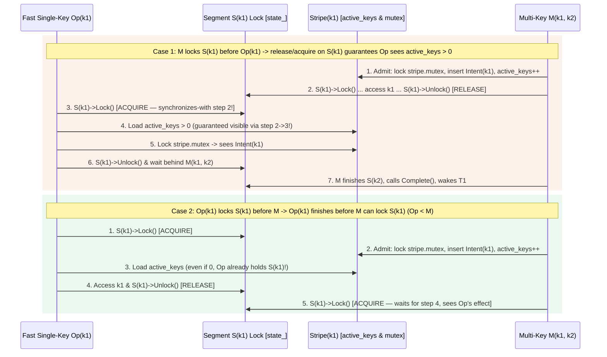

---

## 5. Multi-Key and Multi-Command Atomic Transactions (`MULTI`/`EXEC`, `WATCH`, `EVAL`)

### 5.1 Why Shared-Everything Simplifies Multi-Command Transactions

In Dragonfly's shared-nothing architecture, a `MULTI`/`EXEC` block or Lua `EVAL` script touching keys across multiple shards requires:
1. Scheduling the transaction into every involved shard's `TxQueue` via VLL/Calvin lock-ahead (`StartMultiLockedAhead`), or acquiring a global barrier (`GLOBAL`).
2. Dispatching individual commands or squashed batches across threads via `FiberQueue` RPC hops (`MultiCommandSquasher`) and waiting on barriers.
3. For `EVAL`, hopping from the connection thread to target shards on every `redis.call()` (unless all keys fall on a single shard).

In the **shared-everything architecture**, the connection fiber executing `EXEC` or `EVAL` can directly lock and mutate any `Segment` of the shared `DashTable` on its own proactor thread. Multi-command atomicity and isolation require **zero cross-thread RPC hops**: the connection fiber admits logical intents for all transaction keys upfront, executes all commands locally against the shared `DashTable`, and releases the intents on completion.

### 5.2 `WATCH` / `UNWATCH` (Optimistic Concurrency Control) Without `seq_cst`

Instead of storing watched keys in a per-shard `DbTable::watched_keys` map, watched keys are partitioned across the 64 `Stripe`s alongside the intent queues:

```cpp
struct WatchedKeyEntry {
  DbIndex db_ind;
  std::string key;
  absl::InlinedVector<std::atomic<bool>*, 2> dirty_flags;
};

struct alignas(64) Stripe {
  MetadataMutex mutex;
  std::atomic<uint32_t> active_keys{0};
  std::atomic<uint32_t> watched_count{0};  // Fast-path bypass when 0
  absl::flat_hash_map<uint64_t, IntentQueue> keys;
  absl::flat_hash_map<uint64_t, absl::InlinedVector<WatchedKeyEntry, 1>> watched_keys;
};
```

1. **`WATCH k1 k2 ...` (Synchronized via `SegmentLock`)**:
   - For each key `k`, compute `(hash, stripe)`.
   - First acquire `S(k)->LockShared()` (`std::memory_order_acquire`) and check whether `k` currently exists (recording `exec_info.watched_existed` so silent lazy TTL expiration between `WATCH` and `EXEC` is detected).
   - While still holding `S(k)->LockShared()` (which obeys the global `SegmentLock -> stripe.mutex` lock hierarchy), lock `stripes_[stripe].mutex`, append `&conn->exec_info.watched_dirty` to `watched_keys[hash]`, increment `stripe.watched_count` (`std::memory_order_relaxed`), and unlock `stripes_[stripe].mutex`.
   - Finally call `S(k)->UnlockShared()` (`std::memory_order_release`).
2. **Write Notification (`NotifyWatchers`, No `seq_cst` Needed)**:
   - Whenever any write operation (`SET`, `DEL`, `MSET`, `INCR`, `HSET`, `EXEC`, or lazy expiry) modifies key `k`, it holds `S(k)->LockExclusive()` (`std::memory_order_acquire`).
   - Because `WATCH k` incremented `stripe.watched_count` *before* calling `S(k)->UnlockShared()` (`release`), any writer acquiring `S(k)->LockExclusive()` (`acquire`) *after* `WATCH k` is **guaranteed by the `release`/`acquire` sequence on `S(k)->state_`** to see `stripe.watched_count > 0` without any `seq_cst` barrier!
   - **Fast Path (`stripe.watched_count.load(std::memory_order_relaxed) == 0`)**: Zero overhead; `stripe.mutex` is not touched.
   - **Slow Path (`watched_count > 0`)**: Under `stripe.mutex`, look up `hash(k)` in `stripe.watched_keys`. For any matching `(db_ind, key)`, store `true` (`std::memory_order_release`) into every registered `dirty_flag*`, erase the entry, and decrement `stripe.watched_count`.
3. **`UNWATCH` / `DISCARD` / Connection Close**:
   - Iterates `exec_info.watched_keys`, locks each corresponding `stripe.mutex`, removes `&exec_info.watched_dirty`, and decrements `stripe.watched_count`.

### 5.3 `MULTI` / `EXEC` Execution Protocol

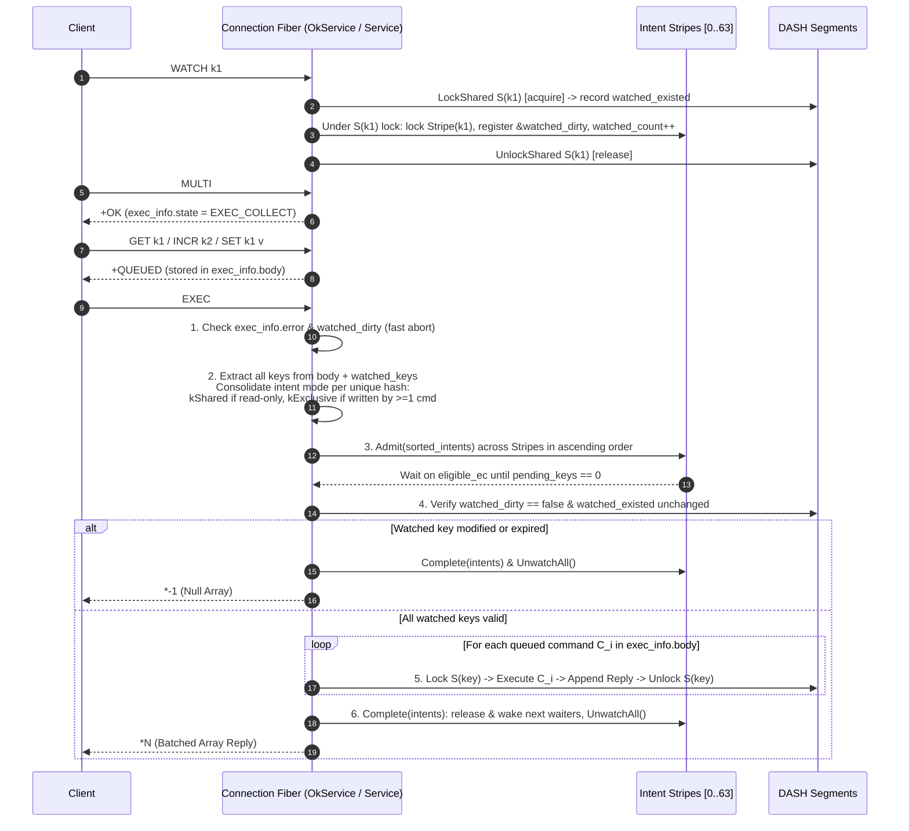

#### Critical Design Detail: Intent Mode Consolidation (No Lock Upgrades)

A `MULTI`/`EXEC` block may first read a key and later write to the same key (e.g., `GET k` followed by `SET k new_val`).
- During step 2 (`PrepareExec`), all commands in `exec_info.body` (plus `watched_keys`) are scanned before `Admit()`.
- Each unique key hash $h$ is assigned a **single consolidated `Intent`**:
  $$\text{mode}(h) = \begin{cases} \text{kExclusive} & \text{if any command in } \text{body} \text{ writes to } h \\ \text{kShared} & \text{otherwise (only read or watched)} \end{cases}$$
- **Why this matters**: By requesting `kExclusive` upfront whenever any command in the transaction writes to $h$, `EXEC` never upgrades a granted `kShared` intent to `kExclusive` mid-transaction. Two concurrent `EXEC` blocks that both read and write $h$ are strictly ordered at `Admit()` time without any upgrade deadlock.
- **Why `watched_keys` are included in `Admit` as `kShared` intents**:
  Including `watched_keys` in the admitted intent set guarantees that while `EXEC` is verifying `watched_existed` and executing its body, no concurrent writer can mutate a watched key `w` after the post-admission check and before `EXEC` finishes, providing true serializability for `WATCH` + `MULTI`/`EXEC` read-write transactions.

#### Segment Lock Scope Inside `EXEC`

While `EXEC` holds its logical intents across all keys:
- By default, each command $C_i$ in `exec_info.body` acquires and releases the `SegmentLock` for its key(s) only for the duration of $C_i$ (bypassing the stripe check because `EXEC` already owns the logical intent!).
- **Consecutive Same-Segment Coalescing**: If $C_i$ and $C_{i+1}$ operate on keys that map to the same `SegmentType*` with compatible lock modes, the connection fiber can keep `SegmentLock` held across $C_i$ and $C_{i+1}$, amortizing the atomic CAS cost.

### 5.4 Lua Scripts (`EVAL` / `EVALSHA`)

1. **Scripts with Declared Keys (`KEYS[1..N]`)**:
   - Compute `(hash, stripe)` for `KEYS[1..N]` (`kShared` for `EVAL_RO` / read-only scripts, `kExclusive` otherwise).
   - Call `Admit()` once before entering Lua.
   - Run the Lua script **directly on the calling connection fiber**. Every `redis.call()` inside Lua executes inline on the same fiber by locking the target `Segment` (`LockSegmentForHash`), mutating or reading the `CompactObj`, and unlocking the `Segment`.
   - Call `Complete()` when the Lua script returns.
2. **Dynamic `dragonfly.lock()` / `dragonfly.unlock()`**:
   - Maps directly to `Admit()` and `Complete()` on the requested key set.
3. **Scripts with Undeclared Keys (`undeclared_keys` flag)**:
   - Acquires a global exclusive intent across all 64 stripes (or a table-wide epoch lock), then runs the script locally on the connection fiber with zero cross-thread hops.

---

## 6. Memory Accounting (`MiMemoryResource`, `zmalloc`, `SmallString`, Table & Object Stats)

### 6.1 What Breaks in Shared-Nothing Memory Accounting Under Multi-Threading

Dragonfly currently tracks memory per shard (`EngineShard::UsedMemoryWithoutSearch()`) as the sum of three thread-local counters:
```cpp
return mi_resource_.used() + zmalloc_used_memory_tl + SmallString::UsedThreadLocal();
```
In a shared-everything architecture where **any proactor thread can allocate, overwrite, or delete any key**, three assumptions in the current implementation break immediately:

1. **Cross-Thread Free Underflow & Heap-Contains Check in `MiMemoryResource`** (`src/core/mi_memory_resource.cc`):
   - `MiMemoryResource::do_allocate` allocates from the thread's `heap_` (`mi_heap_malloc_aligned(heap_, size, align)`) and increments an unsigned `size_t used_`.
   - `MiMemoryResource::do_deallocate` asserts:
     - `DCHECK(size > 33554400 || mi_heap_contains_block(heap_, ptr));`
     - `DCHECK_GE(used_, size); used_ -= usable;`
   - If Thread $A$ executes `SET k val1` and Thread $B$ later executes `SET k val2` or `DEL k`, Thread $B$ frees `val1`'s buffer (which belongs to Thread $A$'s `mi_heap_t*`). On Thread $B$, `mi_heap_contains_block(heap_B, ptr)` fails immediately, and Thread $B$'s unsigned `used_` underflows while Thread $A$'s `used_` grows without bound!
2. **`SmallString` / `SegmentAllocator` Thread-Local Address Table Crash** (`src/core/segment_allocator.h`, `src/core/small_string.cc`):
   - `SmallString` compresses a 64-bit pointer into a 32-bit `small_ptr_ = (seg_offset << 10) | seg_idx`, where `seg_idx` is an index into **thread-local** `tl.seg_alloc->address_table_`.
   - If Thread $A$ allocates a `SmallString`, `seg_idx` refers to Thread $A$'s `address_table_`. When Thread $B$ reads (`SmallString::Get()`) or frees (`SmallString::Free()`) that key/value, `tl.seg_alloc->Translate(small_ptr_)` indexes into **Thread $B$'s** `address_table_`, dereferencing an unrelated 32MiB segment or out-of-bounds memory!
3. **Contended / Non-Atomic `DbTableStats`** (`src/server/table.h`):
   - `DbTableStats` (`obj_memory_usage`, `inline_keys`, `expire_count`, `memory_usage_by_type[]`, and `SlotStats[]`) are plain non-atomic integers mutated by `AccountObjectMemory` and `DbSlice::AutoUpdater`.

### 6.2 Shared-Everything Memory Accounting Architecture

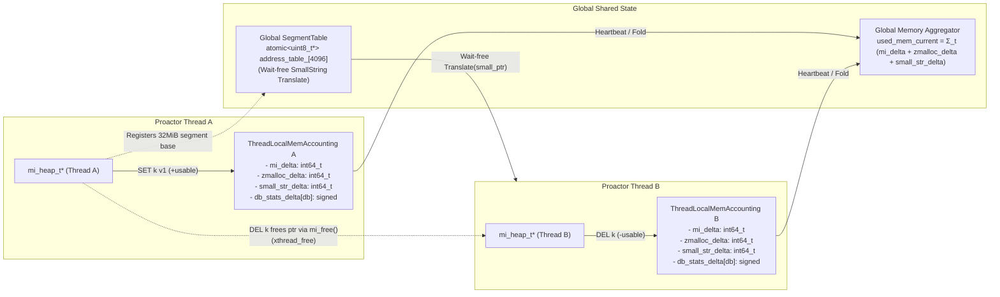

#### 1. Per-Thread `mi_heap_t*` with Signed Delta Accounting (`MiMemoryResource` & `zmalloc`)

`mimalloc` is natively architected for multi-threaded allocation where each thread allocates from its own thread-local `mi_heap_t*` (zero lock contention on `malloc`) and any thread can call `mi_free(ptr)` on pointers allocated by other threads (routed via atomic per-page `xthread_free` lists).

To make `MiMemoryResource` and `zmalloc` work seamlessly across threads with **zero atomic RMWs on the allocation/deallocation path**:
- Each proactor thread $t \in [0, N)$ still initializes its own `mi_heap_t*` and thread-local `MiMemoryResource`.
- Change `MiMemoryResource::used_` from `size_t` to **`int64_t net_used_ = 0`** (and keep `zmalloc_used_memory_tl` as `ssize_t`):
  - `do_allocate(size, align)`: allocates from `tl_heap`, adds `+static_cast<int64_t>(mi_usable_size(res))` to `net_used_`.
  - `do_deallocate(ptr, size, align)`: removes `DCHECK(mi_heap_contains_block(heap_, ptr))` and `DCHECK_GE(used_, size)`, subtracts `static_cast<int64_t>(mi_usable_size(ptr))` from `net_used_`, and calls `mi_free_size_aligned(ptr, size, align)`.
- **Conservation Invariant**:
  Every live block allocated on thread $A$ contributed $+U$ to `tls[A].net_used_`. When freed on thread $B$, `mi_usable_size(ptr)` returns the exact same block size $U$ and contributes $-U$ to `tls[B].net_used_`. Therefore, at any instant:
  $$\text{Total Used Memory} = \sum_{t=0}^{N-1} \left(\text{tls}[t].\text{mi\_net\_used} + \text{tls}[t].\text{zmalloc\_used\_tl} + \text{tls}[t].\text{small\_str\_net\_used}\right) \ge 0$$
- **Fast Global Queries (`used_mem_current`)**:
  Each proactor thread's periodic heartbeat (or every $64\text{ KB}$ of local net change) flushes its local delta into the global `std::atomic<int64_t> used_mem_current` via `fetch_add(delta, std::memory_order_relaxed)`, so `maxmemory` checks on the command path read a single relaxed atomic scalar while `INFO MEMORY` can sum the $N$ cache-line-aligned thread counters for exact byte accuracy.

#### 2. Wait-Free Cross-Thread `SmallString` (`GlobalSegmentTable`)

To allow any thread to read, defragment, or free a `SmallString` allocated by any other thread:
- Replace the per-thread `std::vector<uint8_t*> address_table_` in `SegmentAllocator` with a **process-wide lock-free table**:
  ```cpp
  class GlobalSegmentTable {
    // 12 bits = 4,096 segments * 32MiB = 128GiB (or 10 bits = 32GiB)
    static constexpr uint32_t kSegmentIdBits = 10;
    static constexpr uint32_t kMaxSegments = 1u << kSegmentIdBits;

    std::atomic<uint8_t*> address_table_[kMaxSegments]{};
    std::atomic<uint32_t> count_{0};
    util::fb2::Mutex reg_mu_;
    absl::flat_hash_map<uint64_t, uint16_t> global_rev_idx_;
  };
  ```
- **Wait-Free Translation on Any Thread (`SmallString::Get`, `Equal`, `Free`, `MallocUsed`)**:
  `Translate(Ptr p)` simply loads `g_segment_table.address_table_[p & kSegmentIdMask].load(std::memory_order_relaxed) + Offset(p)`. Because registered 32MiB segment base addresses are append-only in `address_table_`, translation requires **zero locks and zero thread-local state**.
- **Fast Thread-Local Registration Cache on `Allocate`**:
  Each thread keeps a 1-entry cache `(last_seg_ptr, last_seg_id)` plus its thread-local `rev_indx_`. A thread only acquires `g_segment_table.reg_mu_` when `mimalloc` allocates a brand-new 32MiB segment (at most once per 32MiB of allocations!).
- **Signed Accounting**: `tl.small_str_bytes` is changed from `size_t` to `ssize_t`, adding `+mi_usable_size(rp)` on `Assign` and subtracting `-mi_usable_size(p)` on `Free`.

#### 3. Table, Object, and Per-Type Memory Accounting (`table_memory`, `obj_memory_usage`)

| Metric | How It Is Tracked in Shared-Everything | Contention / Cost |
| :--- | :--- | :--- |
| **Table Memory (`table_memory`)** | `unique_segments_.load(relaxed) * sizeof(SegmentType) + (1ULL << global_depth) * sizeof( void* )`. Updated only inside `Split()` / `Clear()` under `split_mu_`. | **Zero** on normal reads/writes |
| **Key Count (`prime.size()`)** | Tracked per `Segment` (`Segment::size_` updated under `SegmentLock` Exclusive) **and** in per-thread signed delta `tl_db_stats[db].key_delta`. | **Zero** cross-thread cache-line bouncing |
| **Object Memory (`obj_memory_usage`)** | Each proactor thread $t$ owns a cache-line-aligned `DbTableStatsDelta tl_db_stats[db]` with signed `int64_t obj_memory_usage`, `inline_keys`, `expire_count`, and `memory_usage_by_type[OBJ_TYPE_MAX]`. | **Zero** atomic ops on mutation path (thread updates its own `tl_db_stats[t]`) |
| **Per-Segment Object Bytes** | Optional `uint64_t obj_bytes_ = 0` inside `detail::Segment` (updated under `SegmentLock` Exclusive alongside `size_`), giving exact per-segment memory density for eviction. | Updated under existing `SegmentLock` |
| **Cluster `SlotStats` (`memory_bytes`, `key_count`)** | Either sharded per-thread (`tl_slot_stats[t][slot]`) or stored as `std::atomic<int64_t>` per slot (16,384 slots reduce contention by $16384\times$). | Negligible |

When a thread mutates a key inside a segment under `S->LockExclusive()`:
- Before mutation: `ssize_t old_key_mem = it.key().MallocUsed(); ssize_t old_val_mem = it.val().MallocUsed();`
- After mutation: `ssize_t new_key_mem = it.key().MallocUsed(); ssize_t new_val_mem = it.val().MallocUsed();`
- The thread applies `(new_key_mem - old_key_mem)` and `(new_val_mem - old_val_mem)` directly to its own `tl_db_stats[t][db]` and to `S->obj_bytes_`.

---

## 7. Defragmentation Approaches in Shared-Everything

### 7.1 Challenges of Multi-Threaded Defragmentation with `mimalloc`

In shared-nothing Dragonfly, `EngineShard::DoDefrag` relies on two invariants that do not hold in shared-everything:
1. **Exclusive Shard Access**: `DoDefrag` assumes no other thread can access the shard's `DashTable` or `CompactObj`s while the idle fiber runs.
2. **Same-Heap Page Ownership**: `mi_heap_page_is_underutilized(mi_heap_t* heap, void* p, float ratio)` (`patches/mimalloc-v2.5.2/2_return_stat.patch`) checks `page_heap == heap` and returns `MI_DFLY_HEAP_MISMATCH` whenever `p` was allocated by a different `mi_heap_t*`.
   - In shared-everything, keys in any DASH `Segment` were allocated across all $N$ proactor threads (`heap_0 .. heap_{N-1}`). Checking `page_heap == calling_thread_heap` would cause a defragmenter on thread $t$ to skip $\frac{N-1}{N}$ of all objects!
3. **Cross-Thread Delayed Free Lists (`xthread_free`)**:
   - In `mimalloc`, when Thread $B$ frees a block `p` belonging to a page owned by Thread $A$'s `mi_heap_t`, `mimalloc` atomically pushes `p` onto `page->xthread_free` without decrementing `page->used`.
   - `page->used` is only decremented when Thread $A$ collects its delayed frees (`_mi_page_free_collect` / `mi_heap_collect`). If Thread $A$ does not drain its `xthread_free` lists, underutilized pages appear full (`page->used == page->capacity`) and are never defragmented or retired!

### 7.2 Defragmentation Design for Shared-Everything

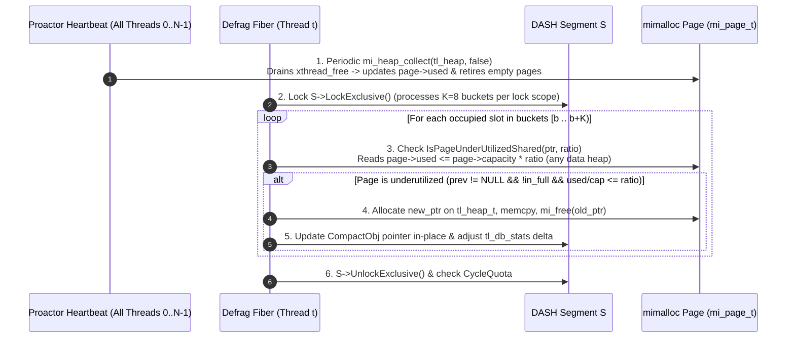

#### Approach 1: Cooperative All-Heap Value Defragmentation Under `SegmentLock` (Recommended)

1. **Heap-Agnostic Page Utilization Check (`mi_page_is_underutilized_shared`)**:
   - Extend our `mimalloc` patch with `mi_page_is_underutilized_shared(void* p, float ratio, bool collect_stats)`:
     - Resolves `mi_page_t* page = _mi_ptr_page(p)` and `mi_heap_t* page_heap = mi_atomic_load_acquire(&page->xheap)`.
     - Instead of requiring `page_heap == calling_thread_heap`, verifies `page_heap != nullptr` (is a valid live mimalloc heap) and `page->flags.x.in_full == 0 && page->prev != nullptr`.
     - Reads `uint32_t used = page->used` and `uint32_t cap = page->capacity` and returns `MI_DFLY_PAGE_BELOW_THRESHOLD` when `used <= cap * ratio`.
     - Note: Even if `page` belongs to another thread $T_i$, `_mi_ptr_page(p)` is stable while `p` is allocated (and we hold `S->LockExclusive()`, so `p` cannot be freed concurrently!). Reading `page->used` and `page->capacity` as a heuristic is race-free with respect to object lifetime.
2. **Pre-Defrag `xthread_free` Drain on Every Proactor**:
   - Each proactor thread runs a lightweight periodic step (in its heartbeat or idle task before `DefragTask`) that calls `mi_heap_collect(tl_heap, /*force=*/false)` (or drains `heap->thread_delayed_free` and active page `xthread_free` lists).
   - This ensures that blocks freed by other threads—and blocks evacuated by defragmentation—are promptly reclaimed into `page->used`, allowing completely emptied pages to be retired back to the OS/segment cache.
3. **Fine-Grained Segment-Locked Scanning**:
   - The `DashTable` segment space is partitioned across the $N$ proactor idle defrag fibers (thread $t$ scans segments whose canonical prefix mod $N == t$, or advances a shared atomic cursor `std::atomic<uint64_t> defrag_cursor_`).
   - For a target segment `S`:
     - Acquire `S->LockExclusive()`.
     - Scan a bounded batch of buckets (e.g., 4–8 buckets) and call `it->first.DefragIfNeeded(&page_usage)` and `it->second.DefragIfNeeded(&page_usage)`.
     - Release `S->LockExclusive()` between bucket batches so normal `GET`/`SET` traffic on `S` experiences sub-microsecond latency impact.
   - **Why Defragmentation Does Not Need Logical Intent Locks**:
     - Defragmentation is a purely **physical** transformation: it does not change any key's logical existence, value, TTL, or version.
     - Because any in-flight `MGET`, `MSET`, or `EXEC` must acquire `S->LockShared()` or `S->LockExclusive()` before dereferencing any `CompactObj` inside `S` (and releases all `CompactObj` references before unlocking `S`), holding `S->LockExclusive()` guarantees no other thread has an active pointer into the `CompactObj` being reallocated!

#### Approach 2: Owner-Thread Delegated Reallocation (Alternative if Strict Heap Affinity Is Desired)

If we want to avoid cross-thread `mi_free` traffic during defragmentation bursts:
- While scanning segment `S` under `S->LockShared()`, if `IsPageUnderUtilizedShared(ptr)` returns true for a block owned by `heap_owner_tid != my_tid`, the scanner can enqueue `(db_ind, key_hash, key)` into `owner_tid`'s lock-free defrag work queue, or simply let `my_tid` reallocate it into `my_tid`'s local `mi_heap_t*` (which naturally balances memory ownership toward active threads). Reallocating directly on `my_tid` under `S->LockExclusive()` (Approach 1) is simpler and requires no key re-lookup.

#### Approach 3: Defragmenting `DashTable` Segments Themselves (`TryRelocateSegment` / `Merge`)

- Each `detail::Segment` is ~32KB (`kPrimeSegmentSize <= 32304`), occupying an entire 32KB `mimalloc` page on its own, so `Segment` allocations do not suffer from small-block page fragmentation.
- However, if segment relocation (`TryRelocateSegment`) or buddy-segment merging (`Merge`) is ever needed in concurrent mode, it is supported safely using the **Retired-Depth Sentinel (`kRetiredDepth = 0xFF`)**:
  1. Acquire `S->LockExclusive()` and `split_mu_`.
  2. Verify `S->IsSafeToDefragment()` (`live_iterators_.load() == 0`).
  3. Allocate `S_reloc`, move-construct `*S_reloc = std::move(*S)`, and set `S->local_depth_.store(0xFF, std::memory_order_relaxed)`.
  4. Update `dir->segments[start .. start + chunk)` to `S_reloc` with `std::memory_order_release`.
  5. Release `split_mu_` and `S->LockExclusive()`.
  6. Any thread that had loaded `S` from `dir_` prior to step 4 and was waiting on `S->LockShared()`/`LockExclusive()` wakes up, checks `S->Owns(hash)` (which returns `false` because `local_depth_ == 0xFF`), unlocks `S`, and reloads `S_reloc` from `dir_`!
  7. `S` is freed once all proactor threads advance past the current fiber epoch (EBR).

---

## 8. Snapshotting Isolation and `DashTable` Traversal

### 8.1 Point-in-Time (PIT) Isolation Without Stopping the World

A snapshot (RDB save or replica full sync) must produce a **point-in-time consistent cut** of the shared `DashTable` at snapshot start time $t_{\text{snap}}$ while all proactor threads continue executing concurrent reads, writes, and segment splits.

We adapt Dragonfly's versioned-bucket Copy-on-Write (Push-on-Write) algorithm (`VersionedBB`) to the shared-everything architecture, with a key simplification that **eliminates `BucketDependencies` latches and iterator laundering**:

> **Core Invariant (Copy-Under-SegmentLock, Flush-Outside-SegmentLock)**:
> Every physical bucket in `DashTable` holds at most **12 slots**. Whenever a bucket with `bucket.GetVersion() < snapshot_version_` is visited (either by the background snapshot traversal or by a writer's pre-modify hook), its entries are serialized into a **thread-local in-memory `RdbSerializer` buffer while holding `SegmentLock`**, and `bucket.SetVersion(snapshot_version_)` is stamped immediately before releasing `SegmentLock`. Socket/disk I/O and heavy compression flushes happen **after** `SegmentLock` is released.

Because `SegmentLock` is never released mid-bucket-serialization, no fiber ever suspends while a bucket is half-serialized!

### 8.2 Snapshot Lifecycle and Pre-Modify Hook Protocol

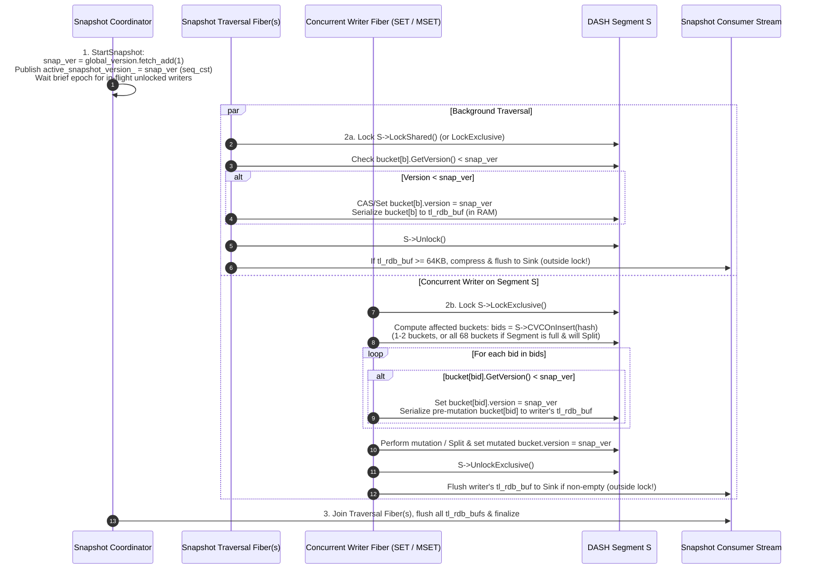

### 8.3 Handling Concurrent Segment Splits, Stash Unloads, and Large Values

1. **Why Segment Splits Preserve Snapshot Completeness and Exact-Once Semantics**:
   - In `DashTable`, when an insertion into segment `S` finds that `S` is full (and therefore may trigger `GarbageCollect`, `UnloadStash`, `Evict`, or `Split`), `S->CVCOnInsert(key_hash, bids)` returns **`num_buckets()` (all 68 physical buckets of `S`, including the 4 stash buckets)**.
   - Because the writer holds `S->LockExclusive()`, it serializes every bucket in `S` that still has `version < snapshot_version_` and stamps **all 68 buckets of `S` with `snapshot_version_`** *before* calling `UnloadStash` or `Split()`.
   - When `S->Split()` subsequently moves MSB=1 entries into `S_new` and propagates `S`'s bucket versions to `S_new` (`dest_right->bucket_[i].UpdateVersion(src.GetVersion())`), every bucket in both `S` and `S_new` already has `version >= snapshot_version_`.
   - Consequently:
     - No entry in `S` or `S_new` is ever missed (even if `Split` unloads a stash entry into a regular bucket).
     - When the background `DashCursor` traversal later visits `S` and `S_new`, it sees `version >= snapshot_version_` on their buckets and skips them in $O(1)$ without duplicate emission!
2. **Deterministic `CVCOnInsert` Without Retry Loops**:
   - In shared-nothing `DbSlice::AddOrFindInternal`, `CVCUponInsert` required a `for (bool consistent = false; !consistent;)` loop because `CallChangeCallbacks` could suspend on I/O without holding a lock, allowing another fiber on the same thread to mutate the segment in between.
   - In shared-everything, `S->CVCOnInsert` and pre-mutation bucket copying into `tl_rdb_buf` happen **without yielding inside `S->LockExclusive()`**. The candidate bucket set cannot change between `CVCOnInsert` and `InsertUniq`, eliminating the retry loop completely.
3. **Handling Huge Collection Values (Streaming Serialization Without Holding `SegmentLock`)**:
   - Small/medium keys and values (strings, small hashes/sets/lists) are serialized into `tl_rdb_buf` in a few microseconds under `SegmentLock`.
   - If a bucket contains a huge collection (e.g., a `StringMap` or `QList` with $>1,000$ elements):
     - **Option A (Intent-Protected Snapshot Read)**: The traversal fiber acquires a `kShared` logical intent on `hash(key)` in `Stripe`, releases `S->LockShared()`, serializes the large collection in chunks while yielding/flushing freely (protected from mutations by the `kShared` intent!), and releases the `kShared` intent.
     - **Option B (Tagged Chunked Serialization)**: Use Dragonfly's existing `FLAGS_serialization_tagged_chunks` to stream chunks of the collection across yields.
4. **Parallel Multi-File Serialization (`K` `.dfs` Files) and Multi-Socket Replication (`K` `DFLY FLOW` Sockets)**:
   - Using the dynamic $K = 2^p$ **Logical Partitions** defined in Section 3.8 (`partition_id(h, K) = h >> (64 - p)`), any snapshot or replication session spawns $K$ independent `LogicalPartitionStream[0 .. K-1]` instances:
     - **Multi-File `SAVE` / `BGSAVE`**: Opens $K$ `.dfs` shard files (`...-0000.dfs` through `...-(K-1).dfs` plus `...-summary.dfs`). Fiber $j \in [0, K)$ traverses `DashCursor(p, j, 0) .. DashCursor(p, j + 1, 0)` and writes exclusively to File $j$.
     - **Multi-Socket Replication (`DFLY FLOW`)**: Master and replica negotiate $K = 2^p$ parallel TCP flows (`flow_id = 0 .. K-1`). During full sync, Flow $j$ traverses Logical Partition $j$ and streams RDB chunks over **Socket $j$**.
     - **Routing Pre-Modify Hooks & Journal Entries to Stream $j$**:
       - When a concurrent writer fiber modifies segment `S` (holding `S->LockExclusive()`), it computes $j = S\text{->prefix\_} \gg (S\text{->local\_depth\_} - p)$ in $O(1)$.
       - Any pre-mutation buckets in `S` with `version < snapshot_version_` are serialized into a buffer and flushed to `LogicalPartitionStream[j]` (File $j$ / Socket $j$).
       - During stable-state replication, mutations to keys in Logical Partition $j$ append their journal records to `PartitionJournal[j]`, streaming directly over **Socket $j$**.

---

## 9. Uniform Migration of `DbSlice`, `DbTable`, and `EngineShard` (Avoiding Lock Proliferation)

### 9.1 The Problem: Thread-Local State Across `DbSlice`, `DbTable`, and `EngineShard`

In Dragonfly's current shared-nothing architecture, `EngineShard` (`src/server/engine_shard.h`), `DbSlice` (`src/server/db_slice.h`), and `DbTable` (`src/server/table.h`) contain ~25 fields that assume single-threaded access without locks:
- **Multiple database tables**: `db_arr_` (`std::vector<boost::intrusive_ptr<DbTable>>` with non-atomic `thread_unsafe_counter`), `ActivateDb(db_ind)`, `FlushDb(db_ind)`.
- **Secondary per-key tables & maps**: `DbTable::mcflag` (Memcached flags `DashTable`), `DbTable::watched_keys`, `DbSlice::client_tracking_map_` (`CLIENT TRACKING`), and `BlockingController` (`BLPOP`, `BZPOPMIN`, `XREAD BLOCK`).
- **Value iterators & inner objects**: `FindReadOnly`, `FindMutable`, `AddOrFind`, `DbSlice::Iterator` / `ConstIterator`, `DbSlice::AutoUpdater`, and inner containers (`CompactObj`, `StringMap`, `DenseSet`, `QList`, `BPlusTree`).
- **Operational counters, allocators & sampling**: `mi_resource_`, `AsyncDeleter`, `DbTableStats`, `SliceEvents`, `EngineShard::Stats`, `SlotStats[16384]`, `counter_[]` (`MovingCnt`), `sample_top_keys`, `sample_unique_keys`, `sample_values_hist`.
- **Per-command scratch state**: `fetched_items_` (cache-mode LRU bump-up), `uniq_fps_`, `pending_expired_events_`, `pending_send_map_`.
- **Rare metadata & cursors**: `DashTable::Directory` resizing, `change_cb_` (snapshot/flush-slots hooks), `expire_cursor`, `segment_defrag_cursor`.

Naively wrapping each of these structures in its own mutex would turn a single `GET` or `SET` into 4–6 lock acquisitions and create complex lock-ordering hazards.

### 9.2 The Uniform 4-Rule Architecture (At Most One Lock on the Hot Path)

Instead of ad-hoc per-structure locks, every piece of state in `DbSlice`, `DbTable`, and `EngineShard` is governed by **four uniform rules** so that **a hot-path key operation acquires at most ONE lock (`SegmentLock`)**:

```mermaid
flowchart TB
    subgraph Rule1["Rule 1: Single-Thread Coordinator + AwaitOnAll (Rare Metadata)"]
        Coord["Coordinator Thread (Proactor 0)<br/>ActivateDb, FlushDb, Directory IncreaseDepth,<br/>RegisterOnChange / UnregisterOnChange"]
        TLShadow["Per-Proactor Thread-Local Read Copy<br/>tl_db_arr_[0..15], tl_change_cb_<br/>(Zero locks & zero atomics on command read path)"]
        Coord -->|"pp->AwaitBrief() / RCU Barrier"| TLShadow
    end

    subgraph Rule2["Rule 2: Scoped SegmentGuard Inside Iterator / AutoUpdater"]
        SegLock["DashTable SegmentLock<br/>(ConstIterator = Shared, AutoUpdater = Exclusive)"]
        Inner["Inner Value Structures<br/>CompactObj, StringMap, DenseSet, QList, ZSet<br/>(Remain 100% single-threaded & lock-free)"]
        InlineMeta["Inline Key/Value Metadata<br/>Expire (SDS_TTL_TAG), Memcached mcflag<br/>(No secondary DashTable needed)"]
        SegLock --> Inner
        SegLock --> InlineMeta
    end

    subgraph Rule3["Rule 3: Piggyback Sparse Key Hooks on Stripe[0..63]"]
        StripeGate["Stripe Atomic Counter Fast-Path<br/>(watched_count | tracking_count | blocked_count == 0)"]
        StripeMaps["Stripe-Local Maps (watched_keys,<br/>client_tracking_map_, BlockingController)"]
        StripeGate -->|"Slow path only when > 0"| StripeMaps
    end

    subgraph Rule4["Rule 4: Strictly Thread-Local ProactorSlice"]
        TLState["Per-Proactor Operational State<br/>mi_resource_, AsyncDeleter, DbTableStats, SliceEvents,<br/>SlotStats, TopKeys/HLL Sketches, Per-Fiber Scratch"]
    end
```

---

### 9.3 Rule 1: Single-Thread Coordinator + Cross-Thread Message Passing (`AwaitBrief`) for Rare Metadata Operations

We retain Helio's cross-thread message passing (`ProactorPool::at(0)->Await(...)` and `AwaitBrief(...)`), using it **only for rare control-plane / metadata operations** instead of per-key data commands:

1. **Multiple Databases (`db_arr_[0..dbnum]`, `ActivateDb`, `FlushDb`)**:
   - Each proactor thread $t$ maintains a **thread-local table pointer array** `tl_db_arr_[kMaxDb]` (raw `DbTable*` pointers, no atomic refcounting on lookup).
   - **Hot Path (`GET`, `SET`, `SELECT`)**: Looking up the active database table is a plain thread-local array read `DbTable* db = tl_db_arr_[cntx.db_index];` — **zero locks, zero atomics, zero `intrusive_ptr` reference count contention**.
   - **Cold Path (`ActivateDb` on first `SELECT db_ind`, `FLUSHDB`, `FLUSHALL`)**:
     - If `tl_db_arr_[db_ind] == nullptr` (or on `FLUSHDB`), the fiber hops to the **Coordinator Thread (Proactor 0)**.
     - The Coordinator allocates the new `DbTable` (or replacement `DbTable` for `FLUSHDB`) and broadcasts the new pointer to all proactors via `pp->AwaitBrief([db_ind, new_db](unsigned idx, ProactorBase*) { tl_db_arr_[db_ind] = new_db; })`.
     - Because `AwaitBrief` executes after any currently running non-yielding command step on each proactor has completed (or after active transactions finish), `AwaitBrief` acts as an exact **RCU grace-period barrier (`synchronize_rcu()`)**: on `FLUSHDB`, once `AwaitBrief` returns and active snapshots complete, the old `DbTable*` is destroyed and decommitted asynchronously without any per-command reference counting.
2. **`DashTable` Directory Resize (`IncreaseDepth`)**:
   - As described in Section 3.2, when a segment split requires doubling the `Directory` (`new_depth > global_depth`, which happens fewer than 20 times in the server's lifetime), the split can delegate directory doubling to the Coordinator Thread + `AwaitBrief` barrier, immediately freeing `old_dir` once `AwaitBrief` returns.
3. **Snapshot / Slot-Flush Change Callbacks (`RegisterOnChange` / `UnregisterOnChange`)**:
   - `change_cb_` registration and removal happen only when starting or finishing a snapshot or slot migration.
   - Broadcasting `tl_change_cb_` updates via `AwaitBrief` lets hot-path writers check `if (ABSL_PREDICT_FALSE(!tl_change_cb_.empty()))` on their own thread-local vector with **zero locks**.

---

### 9.4 Rule 2: Embed `SegmentLock` Inside `DbSlice::ConstIterator` and `AutoUpdater` (Zero Locks for Inner Containers & Secondary Key Metadata)

1. **Automatic Scoped Locking via `ConstIterator` and `AutoUpdater`**:
   - Dragonfly command families (`StringFamily`, `HashFamily`, `SetFamily`, `ListFamily`, `ZSetFamily`, `JsonFamily`) already access keys through two uniform `DbSlice` RAII types:
     - `FindReadOnly(cntx, key, type)` $\rightarrow$ returns `OpResult<ConstIterator>`.
     - `FindMutable(cntx, key, type)` / `AddOrFind(cntx, key, type)` $\rightarrow$ returns `OpResult<ItAndUpdater>` (`{Iterator, AutoUpdater}`).
   - In shared-everything:
     - `ConstIterator` embeds a **`SegmentSharedGuard`** (`seg->LockShared()`), releasing it in `~ConstIterator()`.
     - `AutoUpdater` embeds a **`SegmentExclusiveGuard`** (`seg->LockExclusive()`). Inside `FindMutable` / `AddOrFind`, while holding `seg->LockExclusive()`, `DbSlice` performs `TryExpire` and fires `OnChange` (into the thread-local `tl_rdb_buf`).
     - While the command handler mutates `it->second` (`StringMap`, `DenseSet`, `QList`, `BPlusTree`, `CompactObj`), `AutoUpdater` remains on the stack holding `seg->LockExclusive()`.
     - Consequently, **none of the inner data structures (`CompactObj`, `StringMap`, `DenseSet`, `QList`, `ZSet`, `JsonType`) require internal locks or atomic operations**—they remain 100% single-threaded C++ containers protected by the enclosing `SegmentLock`!
     - When `AutoUpdater::Run()` / `~AutoUpdater()` executes at the end of the command's lexical scope, it records the object memory delta into thread-local stats, checks `NotifyWatchers`, **releases `seg->LockExclusive()`**, and then flushes any buffered `tl_rdb_buf` or expiration notifications outside the lock.
2. **Eliminating Secondary Per-Key `DashTable`s (`Expire` and `mcflag`)**:
   - Dragonfly already eliminated the separate `expire` `DashTable` by storing the 8-byte TTL inline inside `PrimeKey` (`SDS_TTL_TAG`, see `DbSlice::AddExpire` / `RemoveExpire`).
   - We apply the exact same principle to **`DbTable::mcflag`** (the 32-bit Memcached flags table): store the 4-byte flag inline in `PrimeValue` / `PrimeKey` when `flag != 0` (or in a small segment-local side array protected by the same `SegmentLock`).
   - This eliminates `DbTable::mcflag` as a separate `DashTable`, removing a second hash lookup and a second lock on every Memcached command and every `DEL` / `EVICT`.

---

### 9.5 Rule 3: Co-Locate Sparse Per-Key Hooks (`watched_keys`, `client_tracking_map_`, `BlockingController`) Inside the 64 Intent `Stripe`s

Auxiliary structures that map a key to waiting or subscribed clients (`WATCH`, `CLIENT TRACKING`, and blocking list/zset/stream commands like `BLPOP`/`BZPOPMIN`/`XREAD BLOCK`) are sparse—most keys have zero watchers, zero tracking clients, and zero blocked poppers:

1. **Partition by `Stripe[0..63]`**:
   - Instead of a global `watched_keys` map, global `client_tracking_map_`, or shard-global `BlockingController`, each of the 64 Intent Stripes (`stripe_id = (hash >> 24) & 63`) holds its own `watched_keys`, `client_tracking_map`, and `blocking_waiters` table under `stripe.mutex`.
2. **Combined Atomic Fast-Path Gate (`stripe.aux_hooks_count`)**:
   - Each `Stripe` maintains atomic counters (or a combined counter `aux_hooks_count = watched_count + tracking_count + blocked_count`) modified under `SegmentLock + stripe.mutex`.
   - When `AutoUpdater` (write) or `FindReadOnly` (read with `CLIENT TRACKING`) holds `SegmentLock`, it checks `if (ABSL_PREDICT_FALSE(stripe.aux_hooks_count.load(std::memory_order_relaxed) != 0))`.
   - When no `WATCH`, `CLIENT TRACKING`, or `BLPOP` is active on that stripe (the common case), the check costs a single L1-cached load and **zero extra locks**.

---

### 9.6 Rule 4: Keep Operational State Strictly Per-Proactor Thread-Local (`EngineShard` $\rightarrow$ `ProactorSlice`)

State that tracks resource usage, statistics, background deletion, or temporary per-command scratch data does **not** belong in the shared `DbTable`—it remains **100% thread-local on each Proactor thread (`ProactorSlice`)**:

| State Currently in `DbSlice` / `DbTable` / `EngineShard` | Shared-Everything Placement (`ProactorSlice` vs. `SharedDb`) | Why Zero Locks Are Needed on Hot Path |
| :--- | :--- | :--- |
| `mi_resource_` (`MiMemoryResource`), `tl_heap_`, `AsyncDeleter` | **Per-Proactor Thread-Local** | Each proactor allocates from its local `mi_heap_t`, tracks signed `int64_t net_used_`, and queues large lazy deletions to its own local `AsyncDeleter` fiber. |
| `DbTableStats`, `SliceEvents`, `EngineShard::Stats`, `SlotStats`, `MovingCnt` | **Per-Proactor Thread-Local Array (`tl_db_stats_[db_ind]`)** | Commands increment plain non-atomic thread-local counters (`hits++`, `mutations++`, `obj_memory_usage += delta`). `INFO` / `DBSIZE` sums across the $P$ proactors via `AwaitBrief`. |
| `sample_top_keys`, `sample_unique_keys`, `sample_values_hist` | **Per-Proactor Thread-Local Sketches** | `TopKeys`, HyperLogLog (`DenseHll`), and `Histogram` are updated lock-free on each proactor and merged across proactors when `StopSample*()` is called. |
| `fetched_items_`, `uniq_fps_`, `pending_expired_events_`, `pending_send_map_` | **Per-Fiber / Per-Command Execution Context** | Collected locally while `SegmentLock` is held (e.g. during `TryExpire` or cache lookup) and drained immediately after `SegmentLock` is released at the end of the command. |
| `expire_cursor`, `segment_defrag_cursor` | **Per-Proactor Logical Partition Cursor (`cursor_[t]`)** | Proactor $t \in [0, P)$ sweeps Logical Partition $t$ (`DashCursor` prefix $t$) independently without cursor contention. |

---

## 10. Integration with `src/facade/ok_main.cc`

### 10.1 Execution Modes and Flags

Add `--datastore_mode` to `ok_main.cc` to allow direct benchmarking between the existing shared-nothing queue architecture and the new shared-everything architecture:
- `--datastore_mode=queued` (existing behavior): per-proactor `Shard` with `fb2::FiberQueue` + `absl::flat_hash_map`.
- `--datastore_mode=shared_dash` (new): single shared multi-threaded `DashTable` with per-segment `SegmentLock` and striped Shared/Exclusive `IntentQueue`s. No `FiberQueue` consumer fibers are spawned.

Supported commands in `shared_dash` mode:
- `GET key`
- `SET key value`
- `MGET key [key ...]`
- `MSET key value [key value ...]`
- `MULTI` / `EXEC` / `DISCARD` / `WATCH` / `UNWATCH`
- `PING [message]`
- `COMMAND`

### 10.2 Interaction with `dfly_facade` Connection Loops (Sync vs. Squashed vs. Coroutines)

In `src/facade/dragonfly_connection.cc`, `Connection::ExecuteBatch()` dispatches parsed commands in a pipeline loop:
- For the head command (`cmd == parsed_head_`), `ExecuteBatch()` passes `AsyncPreference::PREFER_ASYNC` (in V2) or `ONLY_SYNC` (in V1).
- If `OkService::DispatchCommand` executes the command synchronously and writes directly to `cmd->rb()` **without** calling `cmd->SetDeferredReply()`, `ExecuteBatch()` sees `!cmd->IsDeferredReply()` and immediately calls `retire_head()`, advancing `parsed_head_` and `parsed_to_execute_` together to `cmd->next`.
- Consequently, the next command in the pipeline is *also* `parsed_head_` (`is_head == true`).

This gives `ok_main.cc` three clean execution strategies in `shared_dash` mode:

#### Strategy 1: Direct Synchronous Execution on the Connection Fiber (Default)
- `DispatchCommand` does **not** call `cmd->SetDeferredReply()`.
- For `GET`: acquires `seg->LockShared()`, finds the value in the DASH segment, writes `rb->SendBulkString(val)` or `rb->SendNull()` directly while holding the shared segment lock (or copies to a stack/scratch buffer), and releases `seg->LockShared()`.
  - **Zero coroutine frame allocation, zero `FiberQueue` hop, and zero intermediate `std::optional<std::string>` heap allocation** when the value fits in `ReplyBuilder`'s batch buffer!
- For `SET`, `MGET`, `MSET`: executes on the connection fiber via the single-key fast path or multi-key intent protocol and writes the reply directly to `cmd->rb()`.
- `IoLoopV2` / `ExecuteBatch` automatically keeps `reply_builder_->SetBatchMode(true)` across the pipeline and flushes once when the batch finishes.

#### Strategy 2: Segment-Grouped Pipeline Squashing (`DispatchSquashedBatch`)
- When a client sends a pipeline of single-key `GET`/`SET` commands and `SquashPipeline` / `SquashPipelineV2` calls `OkService::DispatchSquashedBatch(first, count, ...)`:
- Instead of grouping commands by `shard_id` and posting to `g_shards[sid].queue->Add(...)`:
  1. Compute `hash = rapidhash(key)` and look up `SegmentType* seg = dir->Lookup(hash)` for each command in the squashable run.
  2. Group commands by `SegmentType*` (determining whether each segment group is read-only or contains writes).
  3. On the **calling connection fiber itself**, iterate over each segment group:
     - Lock `seg` once (`LockShared` if all commands in the group are `GET`, `LockExclusive` if any command is `SET`).
     - Execute all commands in that segment group back-to-back while the segment's buckets are hot in L1/L2 cache (falling back per-command if `stripe.active_keys > 0` has a conflict or if a `SET` triggers a split).
     - Unlock `seg`.
  4. Resolve each `CmdContext` with its reply payload (`ctx->Resolve(...)`).
- This eliminates all cross-thread `FiberQueue` enqueues and `BlockingCounter` wakeups during pipeline squashing while amortizing segment lock acquisitions across commands hitting the same segment.

#### Strategy 3: Optional Coroutine Suspension on Contended Intents
- We do **not** need coroutines for uncontended commands in `shared_dash` mode because there is no cross-thread shard queue hop to await.
- However, if a command in a pipeline blocks on a contended `IntentQueue` (`Admit` returns `waiting > 0`), suspending only the contended command via `AsyncCmd` (`co_await ResolveAwaiter{ctx}` backed by `ctx->blocker`) allows the connection fiber to continue admitting subsequent non-conflicting commands in the pipeline while `ReplyBatch()` preserves strict in-order socket replies.
- For the initial POC, Strategy 1 + Strategy 2 require no coroutine suspension and avoid coroutine frame overhead entirely; Strategy 3 can be toggled via a flag if benchmarking skewed workloads with deep pipelines.

### 10.3 Allocator Ownership and Shutdown

- **Allocator (`mimalloc`)**:
  - `ok_main.cc` already includes `<mimalloc-new-delete.h>`.
  - `DashTable` segments, `Directory` snapshots, and key/value objects are allocated via per-thread `MiMemoryResource` / `mimalloc` heaps with signed per-thread memory delta accounting (Section 6.2), supporting lock-free thread-local allocation (`mi_heap_malloc`) and safe cross-thread deallocation (`mi_free`).
- **Shutdown Order in `RunEngine`**:
  1. `acceptor->Wait()` returns after all listeners and client connections have closed and drained in-flight commands.
  2. Destroy/clear the shared `DashStore` before `pp->Stop()`.

---

## 11. Implementation Plan and Validation Strategy

### Phase 1: Multi-Threaded `DashTable` & Memory Accounting (`src/core/dash.h`, `src/core/mi_memory_resource.*`)
1. Add `SegmentLock` (fiber-aware `RwLock`), `uint64_t prefix_`, `std::atomic<uint32_t> size_`, and `Owns(uint64_t hash)` to `detail::Segment` (controllable via `Policy::kConcurrent = true` so single-threaded Dragonfly `DbSlice` tables pay zero overhead).
2. Add atomic `Directory` snapshot, `split_mu_`, and `retired_dirs_` to `DashTable` when `Policy::kConcurrent` is enabled.
3. Update `MiMemoryResource` and `SmallString`/`SegmentAllocator` for cross-thread deallocation safety (signed per-thread delta accounting and `GlobalSegmentTable`).
4. Implement pre-hashed `Insert`, `Find`, `Erase` and lock-scoped `SegmentGuard` with automatic split revalidation (`while (!seg->Owns(hash))`).
5. Add multi-threaded C++ unit tests in `dash_test.cc` exercising concurrent reads, writes, overwrites, stash overflows, and simultaneous local/global segment splits across multiple proactor threads under ASAN/UBSAN.

### Phase 2: Transactional Intent Store (`DashStore`) & `MULTI`/`EXEC`
1. Implement the 64-stripe `IntentQueue` table supporting `IntentMode::kShared` and `IntentMode::kExclusive` with $O(1)$ reader completion, reader-cohort wakeup, and striped `watched_keys`.
2. Implement the single-key fast path (`stripe.active_keys == 0` bypass under `SegmentLock`), multi-key `MGet` / `MSet`, and consolidated-intent `MULTI` / `EXEC` / `WATCH`.
3. Add deterministic interleaving and stress tests verifying:
   - Atomic `MSET` and `MULTI`/`EXEC` visibility against concurrent `GET` and `MGET` (no torn reads).
   - Concurrent `MGET` / `GET` reader sharing on hot keys without mutual blocking.
   - Deadlock freedom under overlapping `MSET`s and read-then-write `MULTI`/`EXEC` blocks (`GET k; SET k`).
   - `WATCH` optimistic abort when a concurrent writer modifies a watched key.

### Phase 3: Integration into `src/facade/ok_main.cc`, Snapshot/Defrag & Benchmarking
1. Wire `DashStore` into `OkService` in `src/facade/ok_main.cc` behind `--datastore_mode=shared_dash`, supporting `GET`, `SET`, `MGET`, `MSET`, `MULTI`/`EXEC`/`WATCH`, and segment-grouped `DispatchSquashedBatch`.
2. Prototype parallel versioned-bucket snapshot traversal and cooperative segment-locked defragmentation.
3. Benchmark `--datastore_mode=queued` vs `--datastore_mode=shared_dash` across:
   - Uniform single-key `SET` / `GET` (pipeline = 1 and pipeline = 32).
   - Skewed/hot-key `GET` and mixed `GET`/`SET` workloads.
   - Multi-key `MGET` / `MSET` (1, 4, 8 keys) and `MULTI`/`EXEC` transactions mixed with single-key traffic.
